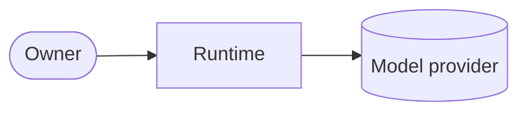

# Writing Raphie's docs

The site in `apps/docs` is the only home of Raphie's documentation. Pages live
in `src/content/docs/<section>/<page>.mdx`; the sidebar is generated from those
folders. `CONTRIBUTING.md` and `CONTEXT.md` stay at the repository root and are
rendered into the Contribute section at build time, so edit them there.

## What a page is for

Each page answers one question a reader actually has: "how do I install this",
"what can a bot's sandbox reach", "how do I recover a lost admin password".
If a page answers several, split it. If two pages answer the same one, merge
them.

Document what Raphie does today. Planned work does not go in guides; if a limit
matters, state the limit ("Telegram can't send files yet"), not the plan.

## Voice

- Lead with the answer, then the detail. The first paragraph after the lede
  should let a hurried reader stop there.
- Short sentences, plain words, second person ("you"), active voice.
- One idea per paragraph; three or four sentences at most.
- No history ("previously", "slice 2", "now implemented"), no internal ticket
  or slice names, no hedging filler ("note that", "it is important to").
- Use the terms in the glossary exactly: a bot is not a session, a bot's
  workspace is not the web workspace, a turn is not a message.

## Shape

Every page has this frontmatter:

```mdx
---
title: Memory # short, noun phrase, sentence case
description: One sentence saying what the reader gets from this page. # shown as the lede
sidebar:
  order: 3 # position within its section
---
```

Do not repeat the title as a `#` heading; the page header renders it.

Then:

1. An opening paragraph (two or three sentences) with the answer.
2. `##` sections in the order a reader needs them: do it, then understand it,
   then limits and recovery.
3. Prefer structure to prose:
   - **Steps** (`<Steps>`) for procedures.
   - **Tables** for settings, defaults, commands, limits, comparisons.
   - **Tabs** (`<Tabs>`/`<TabItem>`) for alternatives such as macOS vs Linux.
   - **Asides** (`:::note`, `:::tip`, `:::caution`, `:::danger`) for the one
     thing a reader must not miss; at most two or three per page.
   - **Mermaid** diagrams (a fenced `mermaid` block) whenever a flow, sequence,
     state machine or topology is being described. Keep them small (under
     about 12 nodes); split big ones. Diagrams scale down to the content
     width, so prefer `flowchart TB` when a left-to-right chart would be more
     than four nodes wide.
4. End with a short "Related" list of links only when it helps.

Import components at the top of MDX files:

```mdx
import {
  Badge,
  Card,
  CardGrid,
  FileTree,
  LinkCard,
  Steps,
  TabItem,
  Tabs,
} from "@astrojs/starlight/components";
```

## Diagrams

Use Mermaid only; no images or standalone HTML. Diagrams are recoloured by the
site theme, so do not set colours or `%%{init}%%` themes in them. Two optional
node classes are available:



`accent` marks the thing the diagram is about; `attention` marks where the
owner must act. Use `subgraph` for boundaries (a process, a machine, a bot).

## Links

- Link between pages with root-relative URLs: `[memory](/guides/memory/)`,
  `[limits](/guides/memory/#limits)`.
- Everything a reader needs is on the site. Link outside it only for
  third-party tools (BotFather, Tailscale, a model provider's key page).
  Source files are fine to name in backticks; do not link to GitHub for docs.

## Accuracy

Docs describe the code, so check defaults, paths, ports, commands, flags and
limits against the source before writing them down. When behaviour, defaults,
settings, storage or API contracts change, update the matching page in the
same change.

## Verify

```sh
bun run --filter @raphie/docs build   # builds and checks every page
bun run --filter @raphie/docs dev     # http://127.0.0.1:4330
```
