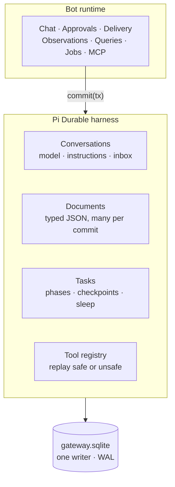
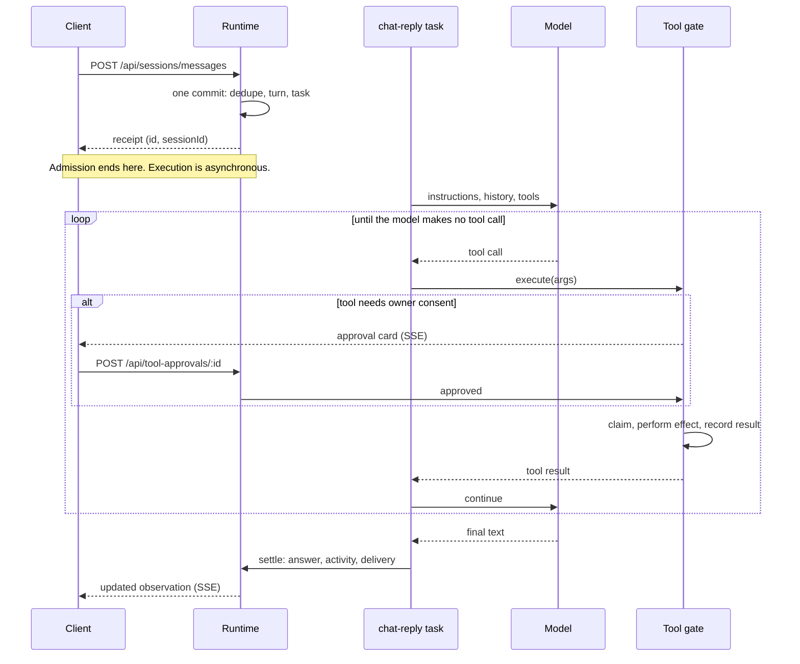
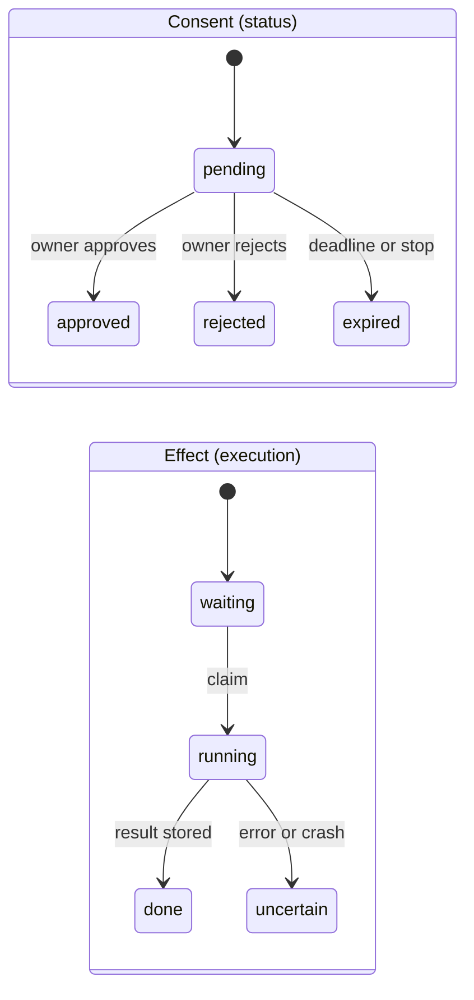

Every change in Raphie commits through Pi Durable, a transactional agent harness over SQLite. A turn has two halves: **admission** (one synchronous transaction that returns a receipt) and **execution** (a durable task that runs the agent loop). Admission is not completion, and approval is not proof that an action ran.

## Durable execution

Raphie has no job queue or state-machine runner of its own. Each bot runtime is a thin set of services over one Pi Durable harness, which stores everything in that bot's `gateway.sqlite`.

| Primitive     | What Raphie relies on                                                                                                                                                                                                               |
| ------------- | ----------------------------------------------------------------------------------------------------------------------------------------------------------------------------------------------------------------------------------- |
| **Harness**   | One per bot. Owns conversations, documents, tasks and their recovery. On start it resumes unfinished tasks.                                                                                                                         |
| **Document**  | Typed JSON state, read and written only inside a commit. One commit can change many documents atomically.                                                                                                                           |
| **Task**      | A resumable state machine. Each phase ends in a commit that returns running (with a checkpoint), sleeping (until a time) or terminal. Tasks are created inside transactions, so enqueueing is atomic with the state that caused it. |
| **Tool**      | Intent is committed before execution. `replay: "safe"` means the tool's own durable gate makes re-execution harmless; `replay: "unsafe"` means it is never re-run after an interruption.                                            |
| **Extension** | A bundle of tools, tasks and prompt sections, installed into a bot's registry and swappable without a restart.                                                                                                                      |

Raphie stores its own state in ten `raphie.*` document kinds:

| Document                                                               | Holds                                                                               |
| ---------------------------------------------------------------------- | ----------------------------------------------------------------------------------- |
| `raphie.chats`                                                         | Conversations (public session ID, title, model), turns and reply deliveries         |
| `raphie.tool-approvals`                                                | Approvals, command session grants, command permission modes, approval notifications |
| `raphie.activity`                                                      | The redacted activity journal, a ring of 5,000 events                               |
| `raphie.delivery-plans`                                                | Persisted multi-part send plans for channels                                        |
| `raphie.channel-bindings`                                              | External conversation to session bindings                                           |
| `raphie.channel-home`                                                  | The bot's selected home destination for scheduled replies                           |
| `raphie.scheduled-jobs`, `raphie.job-runs`, `raphie.schedule-mutation` | Schedules, run history and schedule tool receipts                                   |
| `raphie.gateway`                                                       | Approvals for the older file-copy workflow                                          |

A domain policy, such as "expiry wins over a late decision", is applied inside the same commit that stores its result. The pure policy lives in a `domain` module; the transaction lives in `infrastructure`.

## The turn lifecycle

### Admission

Admission runs in one transaction, behind a gate that also guards model and provider changes.

| Step                   | What happens                                                                                                                                                            | Failure                    |
| ---------------------- | ----------------------------------------------------------------------------------------------------------------------------------------------------------------------- | -------------------------- |
| Check                  | A model must be configured. Text is 1 to 4,000 characters (or empty with at least one attachment), `eventId` is 1 to 200 characters, at most four unique attachment IDs | 503 or 400                 |
| Deduplicate            | The request key is the source plus `eventId`; a fingerprint covers text, session, attachments and model. Same key and same content returns the original receipt.        | 409 if the content differs |
| Resolve the session    | By public session ID, by channel binding, or create a new session with a UUIDv7 ID and a title from the first 70 characters                                             | 404 for an unknown session |
| Apply model rules      | Validate the model against the connected provider's catalogue; refuse a model change while a turn is pending                                                            | 409                        |
| Freeze the destination | A channel turn records its reply destination on the turn. Later configuration changes cannot redirect it.                                                               |                            |
| Freeze the persona     | Snapshot the bot's instructions: memory policy, name, description and SOUL.md, the current time and a fixed guardrail paragraph                                         |                            |
| Enqueue                | Record the pending turn, write `run.accepted` to the activity journal and create the `raphie.chat-reply` task                                                           |                            |

Raster image attachments become image inputs only when the model advertises image support. PDFs and other documents are never sent to the model as files; they stay in the workspace for tools to read.

### Execution

One `raphie.chat-reply` task runs per turn. It submits the input to the Pi conversation with `requestId` set to the turn ID, so a retry after a crash attaches to the same submission instead of duplicating it. Pi then runs the agent loop (model, tools, model) with a 120-second stream timeout and one retry.

When the loop ends, one commit settles the turn: it stores the answer (or an error), finishes any linked scheduled run, writes `run.completed`, `run.failed` or `run.cancelled`, and queues a delivery if the turn came from a channel.

### Queue, steer and stop

| Control                | Effect                                                                                 |
| ---------------------- | -------------------------------------------------------------------------------------- |
| New message while busy | Joins the conversation inbox as a follow-up, run after the current turn                |
| **Steer**              | Moves a waiting web message so it is applied after the current tool round              |
| **Queue**              | Moves it back to run after the current turn                                            |
| **Stop**               | Aborts the run and, in one commit, expires every pending approval in that conversation |

Steer and queue work only for web-origin, non-scheduled turns that Pi has not picked up yet; otherwise they return 409. Stop never undoes a completed external effect, and uncertain effects keep their state.

### Observation

Reads are separate from writes. The runtime watches each active conversation for live text and usage, and each SSE stream recomputes its authoritative snapshot every 150 ms, sending it only when it changed, with a heartbeat every 15 seconds while idle. There is no resume cursor: a reconnect starts from fresh state. A viewer disconnecting never touches durable work.

## Tool approvals

Every tool with an effect outside the model follows the same pattern: **ensure → wait → claim → execute → record**. The approval record is both the unit of consent and the idempotency ledger for the effect. It holds two state machines that never move backwards.

| Rule            | Detail                                                                                                                                                                                                                                          |
| --------------- | ----------------------------------------------------------------------------------------------------------------------------------------------------------------------------------------------------------------------------------------------- |
| Exact arguments | The owner approves the exact, pretty-printed arguments. MCP arguments over 64 KiB are refused as unreviewable. A changed fingerprint (connection, tool or arguments) fails the call.                                                            |
| Deadline        | Approvals expire after 10 minutes. Expiry wins: a decision at or after the deadline yields `expired`. Settled approvals are immutable.                                                                                                          |
| Claim           | Before the effect, a commit re-checks the conversation, task, fingerprint and `approved` status, then moves `waiting` to `running`. A replay of a `done` call returns the stored result; anything else that is not `waiting` becomes uncertain. |
| Uncertain       | A thrown error or crash after the claim marks the action uncertain. The model is told not to repeat it, and nothing retries it.                                                                                                                 |
| Notifications   | Approval cards in channels are deliveries. A failed notification never repeats an approved action.                                                                                                                                              |

### Who must approve what

| Tool class                                             | Ask (default)                             | Full access                         | Command session grant                      | Replay                                  |
| ------------------------------------------------------ | ----------------------------------------- | ----------------------------------- | ------------------------------------------ | --------------------------------------- |
| Workspace command (`workspace_exec`, container `bash`) | Prompt per call                           | Auto-approved for that conversation | Auto-approved for the exact same arguments | Safe                                    |
| Container `read`, `write`, `edit`                      | Not gated; bound to the bot's environment |                                     |                                            | Unsafe                                  |
| MCP tool                                               | Prompt per call                           | Never                               | Never (once only)                          | Safe at the gate, not the remote action |
| MCP documentation lookup tools                         | Allow-listed per connection; no prompt    |                                     |                                            |                                         |
| Memory tools                                           | No prompt (the bot's own store)           |                                     |                                            | Unsafe                                  |

The command permission mode (Ask or Full access) and command session grants apply to workspace commands only. An MCP claim is refused if it carries Full access or a grant, even if a record were forged. Revoking a grant blocks future claims; it cannot undo an action already dispatched.

Channel decisions have extra checks: the same connection, the same thread as the card, and the same user who started the request. When more than one turn is pending, the initiator is ambiguous, so only the web workspace can decide.

## Crash anywhere: what happens next

On start, one recovery transaction runs after each harness opens and before any task resumes. It rewrites in-flight states to truthful ones. Tasks resume only after every bot is attached, so every tool and task definition exists first.

| The process dies during                      | State at that instant                             | After restart                                                                                                                              |
| -------------------------------------------- | ------------------------------------------------- | ------------------------------------------------------------------------------------------------------------------------------------------ |
| The admission commit                         | Nothing (the transaction rolled back)             | The client retries with the same `eventId` and is admitted exactly once                                                                    |
| Model streaming                              | Turn pending, task checkpoint                     | The task resumes; `requestId = turnId` prevents a duplicate submission. Activity shows `run.recovered`.                                    |
| Waiting for approval                         | Approval pending with its deadline                | The wait resumes against the original deadline; expiry still wins                                                                          |
| An MCP call after its claim                  | `execution: running`                              | Marked uncertain with `action.uncertain`; the owner checks the service. A finished call whose result was not yet committed looks the same. |
| A just-bash command                          | Last checkpoint                                   | Discarded; files unchanged                                                                                                                 |
| A container command                          | Command journal row interrupted                   | Reported as an unknown outcome; native writes may persist; not rerun                                                                       |
| A channel send                               | Operation `sending`                               | Marked uncertain; later chunks of the same reply still send                                                                                |
| A memory write                               | Built-in: receipt and evidence in one transaction | Built-in is atomic. Hindsight reports a failure and is never retried blindly.                                                              |
| A scheduled job firing while the bot is busy | Task sleeping                                     | Retries every 5 seconds; never interleaves with interactive work                                                                           |

| Infrastructure failure                      | Behaviour                                                                                         |
| ------------------------------------------- | ------------------------------------------------------------------------------------------------- |
| Container engine down at start              | That bot's container provider is marked unavailable; files are kept and other bots start normally |
| Credential store locked or missing          | The runtime refuses to start (fails closed)                                                       |
| A second runtime on the same data directory | Refused before any store opens                                                                    |
| Browser or SSE connection drops             | Durable work is unaffected; reconnecting gets a fresh snapshot                                    |
| Web host crashes                            | The runtime keeps running, including channels and schedules                                       |

:::caution
Uncertain means "may have happened". Raphie never repeats an uncertain tool call or delivery on its own. Check the external service before you retry by hand.
:::

## Limits

- Live views poll a snapshot diff every 150 ms, and Pi document reads scan retained state. This is sized for one owner, not for many concurrent viewers.
- There is no event-resume cursor for SSE; reconnecting always reloads current state.
- Remote delivery is not exactly-once. An interrupted send becomes uncertain rather than being resent.

## Related

- [Tools](/guides/tools/) and [conversations](/guides/conversations/) for the owner's view of approvals
- [State](/architecture/state/) for how each bot gets its own harness
- [Extensions and channels](/architecture/extensions-and-channels/) for delivery and schedules
