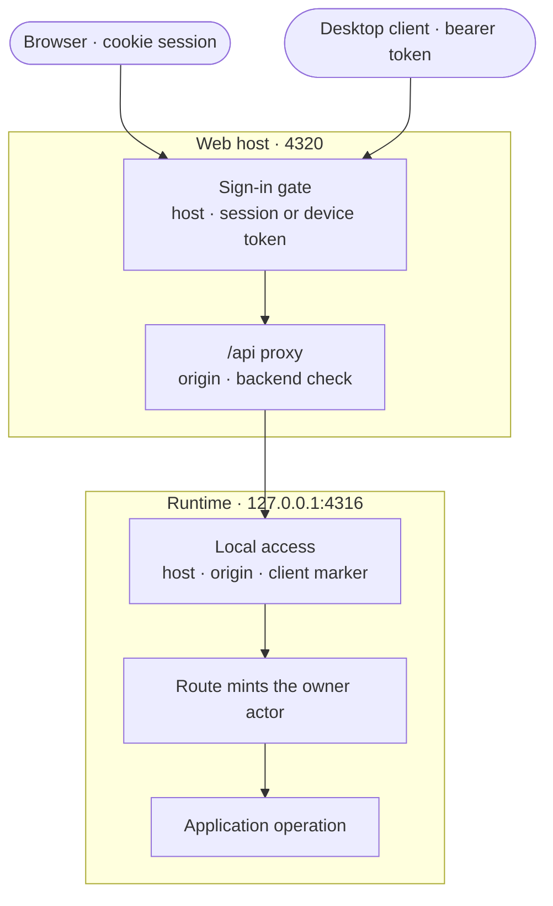

The runtime is headless: it serves a JSON and server-sent events (SSE) API on `127.0.0.1:4316`, and every client, including the web workspace, is just a caller of that API. Remote callers reach it through the web host's authenticated `/api` proxy; the runtime port itself has no credential and must never be exposed.

## Running without the web app

The runtime owns all durable work, so it runs fine with no web host and no browser open. Channels and schedules keep working, and turns continue when every viewer disconnects.

| Command (from source) | Starts                                                                                       |
| --------------------- | -------------------------------------------------------------------------------------------- |
| `bun run dev:runtime` | The runtime only, on loopback port 4316, with configuration loaded through Varlock           |
| `bun run start:web`   | The built web host only (port 4320). It owns no conversation store and makes no model calls. |
| `bun run start`       | Both                                                                                         |

Installed copies run both processes through the `raphie` launcher and service; see [running as a service](/operate/service/).

## How a request is authenticated



| Layer                 | Checks                                                                                                                                                                                                                                                         | Rejects with                                           |
| --------------------- | -------------------------------------------------------------------------------------------------------------------------------------------------------------------------------------------------------------------------------------------------------------- | ------------------------------------------------------ |
| Web host sign-in gate | The `Host` matches a configured origin. Browsers need a valid session cookie; native clients send `Authorization: Bearer <token>` from device sign-in and no cookie or `Origin`. Event streams are re-checked every 2 seconds and close when the session ends. | 403, 401, or a redirect to `/login`                    |
| Web host proxy        | `Origin` matches; the browser's backend ID still matches the configured runtime. Forwards only `content-type`, `x-raphie-client` and `origin`.                                                                                                                 | 403, 409 `backend_changed`, 503 if the runtime is down |
| Runtime edge          | `Host` is `127.0.0.1:<port>` or `localhost:<port>`; `Origin`, if present, is loopback or a configured web origin; every method except `GET` and `OPTIONS` carries `x-raphie-client: web`                                                                       | 403                                                    |
| Actor                 | Each bot's routes mint one owner actor. Identity or destination fields in a JSON body are never trusted.                                                                                                                                                       | 403                                                    |
| Domain policy         | Idempotency, size limits, approval expiry, model rules                                                                                                                                                                                                         | 400, 404, 409                                          |

:::danger
`x-raphie-client` is a cross-site request marker, not a credential. Anything that can open a socket to the runtime port with the right `Host` header acts as the owner. Keep the runtime on loopback and reach Raphie remotely only through the web host. See [security](/architecture/security/) and [remote access](/operate/remote-access/).
:::

The web host also serves its own routes, which never reach the runtime: `/api/auth/*` (sign-in, passkeys, device sign-in and approval, authorized devices), `/api/web/connection`, `/auth/status` and `/_raphie/health`.

## Addressing a bot

| Prefix                 | Addresses                                                                                                                               |
| ---------------------- | --------------------------------------------------------------------------------------------------------------------------------------- |
| `/api/...`             | The default bot                                                                                                                         |
| `/api/bots/:botId/...` | Any bot, including `default`. The host rewrites the path and hands it to exactly that bot's route table; 503 if the bot is unavailable. |
| `/api/bots`            | The bot registry itself (host-level)                                                                                                    |

Every route below works under both prefixes except the bot registry. Through the web host, the same paths are available on its origin.

## Routes

All paths are relative to `/api`. Mutations need `Content-Type: application/json` unless noted, plus `x-raphie-client: web`.

### Sessions and turns

| Method | Path                                           | Purpose                                                                               |
| ------ | ---------------------------------------------- | ------------------------------------------------------------------------------------- |
| POST   | `/sessions/messages`                           | Admit a turn. Returns 201 with the receipt `{ id, sessionId }`.                       |
| GET    | `/sessions?after=<id>&limit=50`                | Session summaries, `{ items, next }`                                                  |
| GET    | `/sessions/events`                             | SSE: the first 100 session summaries, re-sent on change                               |
| GET    | `/sessions/:id`                                | Session observation: recent turns, approvals, live text, activity, phase, saved model |
| GET    | `/sessions/:id/history?before=<turn>&limit=50` | Older turns, oldest first within each page                                            |
| GET    | `/sessions/:id/events`                         | SSE: the session observation, re-sent on change                                       |
| POST   | `/sessions/:id/control`                        | `{ action: "stop" \| "steer" \| "queue", turnId? }`                                   |
| POST   | `/sessions/:id/model`                          | Change an idle session's model                                                        |
| POST   | `/sessions/:id/read`                           | `{ replyCount }`; returns `{ readReplyCount }`                                        |
| GET    | `/runtime`                                     | Model and MCP metadata, uncertain notification IDs                                    |

### Approvals and command permissions

| Method   | Path                            | Purpose                                                               |
| -------- | ------------------------------- | --------------------------------------------------------------------- |
| POST     | `/tool-approvals/:id`           | `{ decision: "approved" \| "rejected", scope?: "once" \| "session" }` |
| GET      | `/sessions/:id/approvals`       | The latest 100 approvals, including pending ones                      |
| GET, PUT | `/sessions/:id/approval-mode`   | Read or set `{ mode: "ask" \| "full-access" }`                        |
| GET      | `/sessions/:id/grants`          | Active command session grants                                         |
| DELETE   | `/sessions/:id/grants/:grantId` | Revoke a grant (204)                                                  |
| GET      | `/tool-approvals/:id.json`      | Download an approval's exact server, tool and arguments               |

### Attachments and workspace

| Method | Path                                  | Purpose                                                                          |
| ------ | ------------------------------------- | -------------------------------------------------------------------------------- |
| POST   | `/attachments`                        | Multipart upload, field `file`, at most 8 MiB. Returns the content-addressed ID. |
| GET    | `/files/:id`                          | Download an uploaded original                                                    |
| GET    | `/workspace`                          | Sandbox settings, provider availability and usage                                |
| POST   | `/workspace/settings`                 | Save sandbox settings; 409 while the bot has pending turns                       |
| GET    | `/workspace/files?path=`              | List a workspace folder                                                          |
| GET    | `/workspace/download?path=&revision=` | Download a workspace file at a listed revision                                   |

### Bots (host-level)

| Method    | Path                | Purpose                                                          |
| --------- | ------------------- | ---------------------------------------------------------------- |
| GET, POST | `/bots`             | List bots; create one from `{ name, description, soul, color? }` |
| GET, POST | `/bots/:id/profile` | Read; update with the current `revision`                         |
| GET       | `/bots/:id/history` | Profile revisions                                                |
| GET       | `/bots/:id/soul.md` | Download SOUL.md                                                 |
| DELETE    | `/bots/:id`         | Delete a named bot; body confirms its `name` and `revision`      |

### Settings, providers and memory

| Method    | Path                                                                 | Purpose                                                                   |
| --------- | -------------------------------------------------------------------- | ------------------------------------------------------------------------- |
| GET, POST | `/settings`                                                          | Read; change default provider and model, telemetry, or a key              |
| POST      | `/settings/connections`                                              | Add a provider connection with an API key                                 |
| POST      | `/settings/connections/:id`                                          | Rename or re-key a connection                                             |
| POST      | `/settings/connections/:id/remove`, `/settings/connections/:id/test` | Remove or test a connection                                               |
| POST      | `/settings/provider/test`                                            | Test the selected provider                                                |
| POST      | `/settings/sign-ins`                                                 | Start a subscription sign-in `{ provider, name, connectionId? }`          |
| GET       | `/settings/sign-ins/:id`                                             | Its events (page to open, device code, progress) and any pending question |
| POST      | `/settings/sign-ins/:id/answer`, `/settings/sign-ins/:id/cancel`     | Answer the pending question; stop a waiting sign-in                       |
| GET, POST | `/memory`                                                            | Read or save memory configuration                                         |
| POST      | `/memory/test`, `/memory/recall`                                     | Test the backend; run a recall query                                      |
| GET       | `/memory/evidence?after=`                                            | Browse built-in evidence, 25 per page                                     |
| POST      | `/memory/evidence/:id`, `/memory/evidence/:id/forget`                | Revise or forget one piece of evidence                                    |

Secrets are write-only: keys and tokens are accepted but never returned.

### Tools, channels and schedules

| Method    | Path                                                      | Purpose                                                                     |
| --------- | --------------------------------------------------------- | --------------------------------------------------------------------------- |
| GET, POST | `/mcp`                                                    | List MCP connections; add an HTTP or stdio connection                       |
| POST      | `/mcp/:id`                                                | `{ action: "enable" \| "disable" \| "remove" \| "import" }`                 |
| GET       | `/channels`                                               | Discord and Telegram settings for the bot                                   |
| POST      | `/channels/discord`, `/channels/discord/remove`           | Save or remove the Discord connection                                       |
| POST      | `/channels/telegram`, `/channels/telegram/remove`         | Save or remove the Telegram connection                                      |
| POST      | `/channels/telegram/pairing`, `/channels/telegram/unpair` | Create a pairing code; unpair a user                                        |
| GET, POST | `/channels/home`                                          | Read destinations; select one with `{ id }`, or `{ id: null }` for web only |
| GET, POST | `/jobs`                                                   | List schedules; add `{ name, prompt, everyMinutes, firstRunAt }`            |
| POST      | `/jobs/:id`                                               | `{ action: "enable" \| "disable" \| "remove" \| "run" }`                    |
| GET       | `/jobs/runs`, `/jobs/notifications`                       | Run history; unread completions                                             |
| POST      | `/jobs/runs/:id/read`                                     | Acknowledge a run                                                           |

### Inspection

| Method | Path                                            | Purpose                                   |
| ------ | ----------------------------------------------- | ----------------------------------------- |
| GET    | `/inspection/activity?before=<event>&limit=100` | Page through the bot's activity journal   |
| GET    | `/diagnostics/traces?hours=1`                   | Trace spans for the last 1, 6 or 24 hours |

### Compatibility routes

These remain for older callers; the current clients do not use them.

| Method | Path                                         | Purpose                                               |
| ------ | -------------------------------------------- | ----------------------------------------------------- |
| GET    | `/chats`, `/events`                          | Whole-bot snapshot and its SSE stream                 |
| POST   | `/chat`                                      | Admit a turn by numeric conversation ID               |
| GET    | `/sessions/legacy/:id`                       | Resolve a numeric conversation ID to its session UUID |
| GET    | `/state`; POST `/messages`, `/approvals/:id` | The file-copy approval workflow                       |

## Sending a message

```json
{
  "text": "Summarise today's notes",
  "eventId": "8f0c3b1e-6a2d-4f7e-9c1a-2b3d4e5f6a7b",
  "sessionId": "0193e7c2-...",
  "model": {
    "provider": "openrouter",
    "modelId": "anthropic/claude-haiku-5.5"
  },
  "approvalMode": "ask",
  "attachments": ["<64-hex upload id>"]
}
```

| Field          | Rule                                                                                                                            |
| -------------- | ------------------------------------------------------------------------------------------------------------------------------- |
| `text`         | Up to 4,000 characters; may be empty only with attachments                                                                      |
| `eventId`      | 1 to 200 characters, stable across retries. Same `eventId` and same content returns the same receipt; different content is 409. |
| `sessionId`    | Omit to start a new session; an unknown ID is 404                                                                               |
| `approvalMode` | Only for a new session; saved before its first turn runs. Defaults to Ask.                                                      |
| `attachments`  | Up to four unique upload IDs from `POST /attachments`                                                                           |

The receipt confirms durable admission, not completion. Follow the session's events or poll its observation to see the reply.

## Session model selection

- A new session uses the bot's default model unless the message carries `model: { provider, modelId }`. An explicit choice is saved with the first turn.
- The model is part of the admission fingerprint, so retrying an `eventId` with a different explicit model is a 409.
- `POST /sessions/:id/model` changes an idle session's model without sending a message. It checks that the provider is connected and the model is in its catalogue, and returns 409 while a turn is pending.
- A session keeps its model through default-model changes and restarts. The observation exposes it as `session.model`.

## Reading state

| Behaviour        | Detail                                                                                                                                                          |
| ---------------- | --------------------------------------------------------------------------------------------------------------------------------------------------------------- |
| Page sizes       | 1 to 100 items; sessions and history default to 50, activity to 100                                                                                             |
| Observation size | Up to 50 recent turns (plus the first pending one if older), the latest 200 activity events and 100 approvals                                                   |
| SSE              | Each stream starts with authoritative state, sends a replacement when it changes, and sends a heartbeat every 15 seconds while idle. There is no resume cursor. |
| Disconnects      | Closing a stream never cancels or resubmits a turn                                                                                                              |
| Phases           | `idle`, `queued`, `model`, `writing`, `tool`, `approval`, `failed`: observed evidence, not private model reasoning                                              |
| IDs              | Public session IDs are UUIDs. Internal Pi IDs and admission fingerprints never appear in responses.                                                             |

Errors are JSON `{ "code": "...", "error": "..." }`. Application errors carry a stable `code`; unexpected errors become a generic 400 without internal detail. Unknown routes return 404.

## Limits

- The runtime has no authentication of its own; remote access always goes through the web host.
- There is no CLI client and no operation to link a channel conversation to an existing session.
- SSE streams poll an authoritative snapshot rather than pushing indexed changes.

## Related

- [Execution](/architecture/execution/) for what admission and approvals guarantee
- [Authentication](/operate/authentication/) for sign-in, passkeys and device tokens
- [Clients](/guides/clients/) for what each client does with this API
