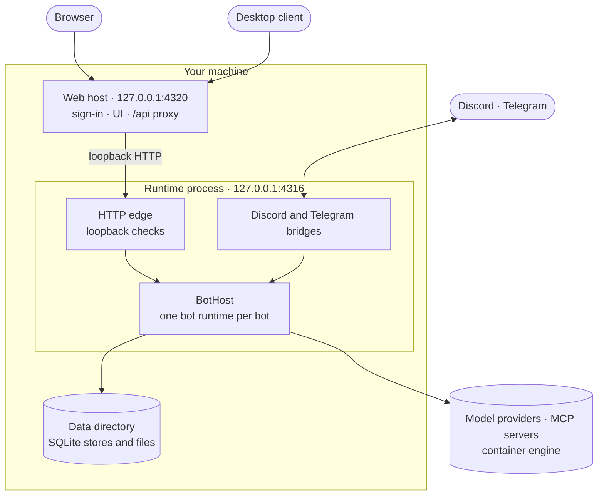
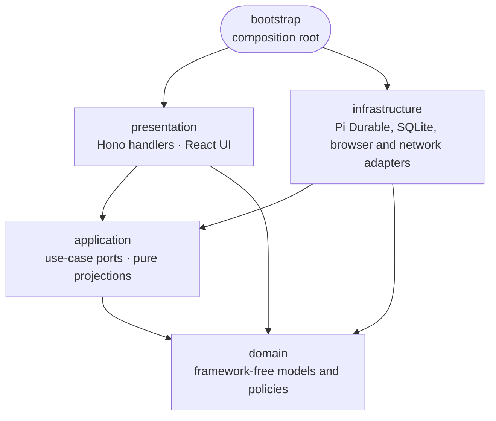
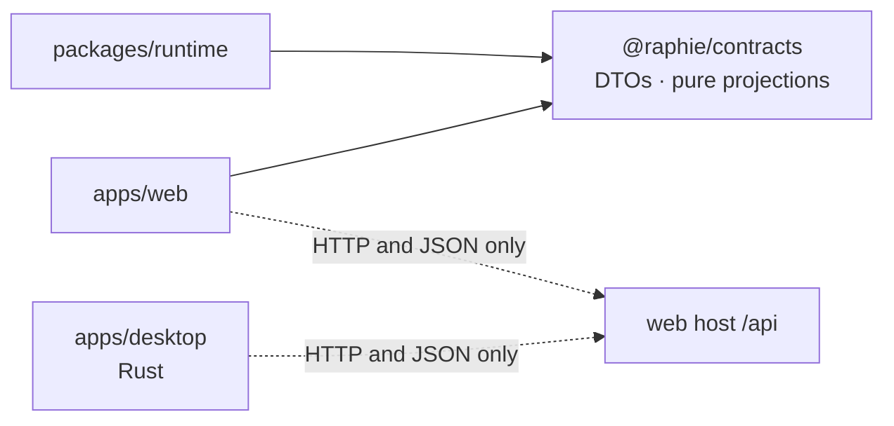

Raphie is a single-owner, self-hosted assistant platform. One long-running **runtime** process owns every bot, session, tool call and side effect. Everything else (the web host, the desktop client, the Discord and Telegram bridges) is a thin adapter that calls the runtime's application operations.

## The whole system

| Part                           | What it owns                                                                                   | What it does not own                                             |
| ------------------------------ | ---------------------------------------------------------------------------------------------- | ---------------------------------------------------------------- |
| **Runtime** (`raphie-runtime`) | Every SQLite store except `auth.sqlite`, model calls, tools, approvals, channels, schedules    | Sign-in, browser sessions                                        |
| **Web host** (`raphie-web`)    | `auth.sqlite` (the administrator, sessions, passkeys, devices), the React UI, the `/api` proxy | Conversations, model calls                                       |
| **Launcher** (`raphie`)        | Starting both processes, `auth setup` and `auth recover`, status and health                    | Any state of its own                                             |
| **Desktop client**             | Its sign-in token and local view state                                                         | Anything durable: it talks to the web host like the browser does |
| **Channel bridges**            | Their connection settings; they run inside the runtime, one per bot connection                 | Session state, which stays in the bot's store                    |

The two server processes share one [data directory](/architecture/storage-and-telemetry/) and talk only over loopback HTTP. Runtime work continues when every client disconnects, and the runtime keeps serving Discord, Telegram and schedules if the web host stops.

## Design rules

Six constraints shape the code. Each one has a concrete mechanism.

| Rule                                                 | How the code enforces it                                                                                                                                              |
| ---------------------------------------------------- | --------------------------------------------------------------------------------------------------------------------------------------------------------------------- |
| State that matters survives any crash point          | All mutation is a transaction over durable documents; recovery is one startup transaction, not a special mode. See [execution](/architecture/execution/).             |
| External effects happen once or are marked uncertain | Tool claims, delivery plans and memory writes are journalled before the effect. An interrupted effect becomes uncertain and is never retried automatically.           |
| One owner is the trust root                          | There is no multi-tenant model. Bots are separated logically, not by the operating system. See [state](/architecture/state/) and [security](/architecture/security/). |
| The core is headless                                 | Clients and channels call the same application operations. See the [HTTP API](/architecture/http-api/).                                                               |
| Nothing beyond the machine                           | SQLite only: no broker, cache or hosted control plane. Two processes, one data directory.                                                                             |
| Dependencies point inward                            | Domain code is framework-free; `bun run architecture` fails the build on a wrong import.                                                                              |

## Tech stack by layer

| Layer             | Choices                                                                                                 | Used for                                                                     |
| ----------------- | ------------------------------------------------------------------------------------------------------- | ---------------------------------------------------------------------------- |
| Browser           | React 19, TanStack Start, Router and Query, Base UI (shadcn-style), Tailwind 4, Vite                    | The web workspace; live updates over server-sent events (SSE)                |
| Web host          | `Bun.serve`, Better Auth (one administrator, passkeys, device sign-in), TanStack Start server rendering | Sign-in gate in front of the UI and the runtime proxy                        |
| Runtime transport | Hono 4.13 on `Bun.serve`, zod 4                                                                         | HTTP routes, SSE, input validation, secure headers                           |
| Runtime lifecycle | Effect 4.1                                                                                              | Scoped startup and shutdown, OTLP trace export                               |
| Agent core        | Pi Durable 1.5 (`pi-durable`, `pi-ai`, `pi-mcp`, `pi-schema`)                                           | Durable harness, documents, tasks, tools, model catalogue, MCP client        |
| Channels          | Chat SDK with its Discord adapter; Telegram Bot API over plain `fetch` with long polling                | Messaging bridges                                                            |
| Execution         | just-bash 3.6 in a worker thread; Docker or Podman CLI; `anydoc-wasm` and `pdfjs-dist` in a worker      | Workspace commands, the opt-in container sandbox, document reading           |
| Storage           | SQLite through `bun:sqlite` (WAL), FTS5, AES-256-GCM, `Bun.secrets`                                     | Every store, memory search, encrypted provider keys, the OS credential store |
| Desktop           | Rust, the Rune UI toolkit, `reqwest` on Tokio                                                           | The native client in `apps/desktop`                                          |
| Toolchain         | Bun 1.4.4, TypeScript 7.0.2, Oxlint (type-aware), `bun fmt`, `bun:test`, Varlock, `bun build --compile` | Build, checks, configuration and the standalone binaries                     |

## Code layering

The runtime (`packages/runtime`) and the web app (`apps/web`) are organised by domain. Each domain under `domains/<context>/` has up to four layers, and imports may only point inward.

| Layer            | Holds                                                                    | May import                                                |
| ---------------- | ------------------------------------------------------------------------ | --------------------------------------------------------- |
| `domain`         | Models and business policies, such as "expiry wins over a late approval" | Relative imports and `@raphie/contracts` only             |
| `application`    | Ports (interfaces) for commands and reads, pure projections              | `domain`, `@raphie/contracts`                             |
| `infrastructure` | Pi Durable transactions and tasks, storage, network and browser adapters | Inner layers and any package                              |
| `presentation`   | Hono route factories, React components                                   | Inner layers; never a harness or SQLite directly          |
| `bootstrap`      | Wiring and process lifecycle                                             | Everything; only `main.ts` and `router.tsx` may import it |

`bun run architecture` (`scripts/check-architecture.mjs`) statically scans imports in `apps/web`, `packages/runtime` and `packages/contracts` and fails on:

- `domain` or `application` importing `infrastructure`, `presentation` or `bootstrap`.
- `domain` importing `application`.
- A core layer importing any package other than `@raphie/contracts`.
- Anything outside `bootstrap` (or the entrypoints) importing `bootstrap`.
- `shared` importing `domains`, `bootstrap` or `presentation`.
- `apps/web` importing the runtime package, or any Radix package.
- A source root holding anything but its entrypoint (`main.ts`, `router.tsx` or `index.ts`).

It is a static import check, not proof that two modules are semantically independent. Pi Durable adapters in `infrastructure` may work across domains, because one SQLite transaction often has to update a turn, an approval and the activity journal together. The policy itself still lives in `domain`.

## Runtime, web and desktop

- **The browser depends on `@raphie/contracts` only.** It holds framework-free wire types (session summaries, observations, history pages, settings) and pure run, tool and usage projections under `@raphie/contracts/projections`. No web module may import runtime internals.
- **The desktop client shares no code.** It is a separate Rust workspace (a UI-free `core` crate and a Rune `app` crate) that mirrors the same JSON contracts and calls the web host's authenticated `/api` with a device token.
- **Channels are adapters, not clients.** The Discord and Telegram bridges run inside the runtime and receive an explicit channel-services port. They never import the process host.

## Related

- [Execution](/architecture/execution/): durable turns, approvals and crash recovery
- [State](/architecture/state/): how bots, memory and workspaces are kept apart
- [HTTP API](/architecture/http-api/): the headless interface every client uses
