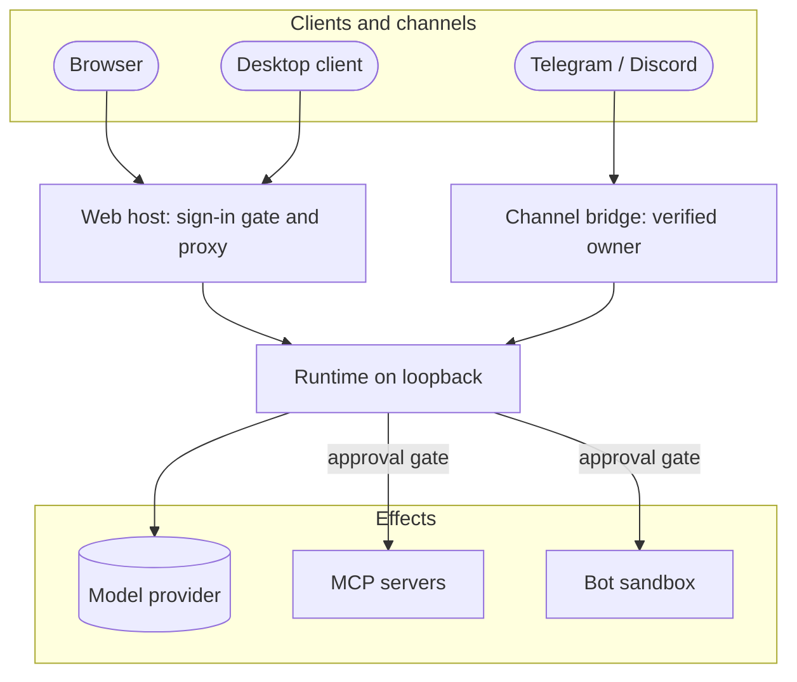
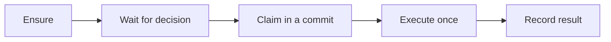
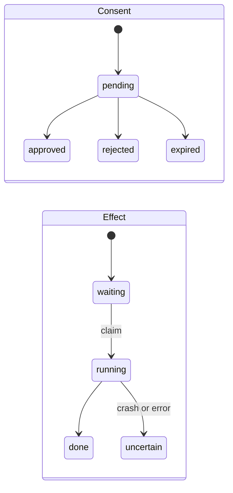

Raphie is a single-owner system. Authority comes from trusted adapters (a signed-in web session, a paired channel account) and never from what a request claims about itself. Every external effect a model proposes goes through an approval record that separates the owner's consent from the effect itself.

## Trust boundaries

| Boundary                           | What crosses it                       | What guards it                                                           |
| ---------------------------------- | ------------------------------------- | ------------------------------------------------------------------------ |
| Network to web host                | Browser and desktop requests          | Configured host, signed-in session, matching `Origin`                    |
| Web host to runtime                | Proxied `/api/*` requests             | Loopback bind, `Host` and `Origin` checks, a client marker               |
| Messaging platform to runtime      | Channel messages and approval buttons | Paired or allow-listed owner accounts, verified per message              |
| Runtime to MCP servers and sandbox | Tool calls proposed by the model      | Per-call owner approval, or an explicit permission mode or grant         |
| Runtime to model provider          | Prompts and tool results              | Encrypted provider credentials; see [credentials](/operate/credentials/) |

## Gates before a mutation

A browser request passes five independent gates. Failing any one stops it; nothing later runs.

| Gate             | Where                      | Checks                                                                                                                                                              | Refusal                                            |
| ---------------- | -------------------------- | ------------------------------------------------------------------------------------------------------------------------------------------------------------------- | -------------------------------------------------- |
| 1. Web gateway   | Web host                   | Configured host; a session re-read from the database on every request; `Origin` for state changes; sign-in bodies bounded to 8 KiB                                  | `403`, `401`, `303` to `/login`, `503` when locked |
| 2. Runtime proxy | Web host                   | `Host` and `Origin` again; the browser's backend matches the current one; forwards only `content-type`, `x-raphie-client` and `origin`; never follows redirects     | `403`, `409 backend_changed`, `503`                |
| 3. Runtime edge  | Runtime                    | `Host` is `127.0.0.1` or `localhost` on the runtime port; `Origin`, if any, is loopback or a configured web origin; non-`GET` requests carry `x-raphie-client: web` | `403`                                              |
| 4. Actor         | Runtime                    | The operation holds an owner context issued by a trusted adapter for that bot                                                                                       | `403`                                              |
| 5. Domain policy | Runtime, inside the commit | Idempotency, input limits, session state (for example, no model change while a turn is pending)                                                                     | `409`, `4xx`                                       |

The runtime also sets a strict Content Security Policy, sends `Cache-Control: no-store`, and maps unexpected errors to a generic message so internals never reach a client. Authentication details are on [authentication](/operate/authentication/).

**Actors cannot be forged.** Each bot has its own issuer. An owner context is a frozen object the issuer records when it creates it, and operations reject any context the issuer did not create. A context cannot be built from JSON, replayed from another bot or chosen by a request. Web routes get one owner context per bot; channel bridges create one per message, bound to the conversation and the verified sender.

**Channels enter at gate 4.** A Telegram message counts only when its sender has paired with the bot using a code from Settings. In groups, unverified text never reaches the model and tool approvals are web-only. Discord accepts only allow-listed users, and an approval must come from the same conversation. See [Telegram](/guides/telegram/).

**Retries are safe.** A turn is keyed by its source and event ID. Repeating a request returns the original receipt; reusing the key with different content is refused with `409`.

## Tool authorization: consent is not effect

Every tool that has an effect outside the model follows the same five steps, all recorded on one approval record.

The record holds the exact arguments shown to the owner and a fingerprint of the connection, tool and arguments. If any of them change between approval and execution, the call fails. Approval and execution are tracked separately:

- **Expiry wins.** A request expires after 10 minutes. A decision that arrives after the deadline records `expired`, whatever was clicked.
- **Claiming re-checks everything.** Before the effect starts, a transaction confirms the approval is still valid for this exact call, permission mode and grant.
- **Done is cached.** Replaying a finished call returns the stored result instead of running it again.
- **Uncertain is never retried.** If Raphie crashed while a call was running, it may or may not have happened. Raphie marks it uncertain and the owner decides what to do.

### Which tools need approval

| Tool                                                    | Ask (default)                           | Full access                              | Session grant                                                |
| ------------------------------------------------------- | --------------------------------------- | ---------------------------------------- | ------------------------------------------------------------ |
| Workspace commands (`workspace_exec`, container `bash`) | Asks per call                           | Runs without asking in that conversation | Repeats of the exact same arguments in the same conversation |
| Container file read, write and edit                     | No prompt; limited to the bot's sandbox | Same                                     | Not applicable                                               |
| MCP tools, including read-only ones                     | Asks per call                           | Still asks                               | Not available                                                |
| MCP documentation lookups chosen per connection         | No prompt                               | No prompt                                | Not applicable                                               |
| Memory tools                                            | No prompt; the owner's own store        | Same                                     | Not applicable                                               |

Full access and session grants never apply to MCP tools. MCP arguments over 64 KiB are refused as too large to review. Grants survive restarts and can be revoked; revoking stops future calls only. See [tools](/guides/tools/) and [workspaces](/guides/workspaces/).

## What plugins can and cannot do

"Plugin" means three different things in Raphie. None of them grants authority.

| Surface            | What it is                                                                             | Can                                                                                         | Cannot                                                                                                |
| ------------------ | -------------------------------------------------------------------------------------- | ------------------------------------------------------------------------------------------- | ----------------------------------------------------------------------------------------------------- |
| UI plugins         | Components compiled into the web workspace, enabled in **Settings → UI plugins**       | Render in a named slot (the composer footer) from the draft, model and usage they are given | Call tools, read other data or reach the runtime; a failing plugin is contained by an error boundary  |
| Runtime extensions | First-party tool sets installed per bot (memory, workspace, documents, schedules, MCP) | Add tools and prompt sections; hot-swap without a restart                                   | Choose their bot or conversation from tool arguments; that scope is fixed when the extension is built |
| MCP servers        | External tool servers connected per bot                                                | Offer tools that the model can propose                                                      | Run a tool without the owner's approval of its exact arguments                                        |

MCP connections are hardened in the runtime:

- HTTP servers must use an `http` or `https` URL with no embedded credentials. A bearer token requires HTTPS unless the server is on loopback. Redirects are refused.
- Only tools the server advertised can be called. Requests time out after 15 seconds and tool calls after 30.
- `stdio` servers start with only `PATH` and the environment you configure; they do not inherit the runtime's environment.
- OAuth sign-in uses PKCE and a one-time loopback callback, and expires after 5 minutes. Tokens are encrypted per connection.

## Credentials

| Credential                                                  | Protection                                                                                   |
| ----------------------------------------------------------- | -------------------------------------------------------------------------------------------- |
| Provider keys, subscription tokens, MCP and channel secrets | Encrypted per connection; the master key is in the OS credential store or an owner-only file |
| Admin password, sessions                                    | Better Auth in `auth.sqlite`, mode `0600`; cookies are `HttpOnly`                            |
| Device tokens                                               | Stored by the desktop client in the OS credential store; revocable from Settings             |

Secrets are write-only through the API: no read response, conversation, Activity entry or trace contains them. Prompts tell the model that personality never grants capabilities and that chat text is not an approval. Details are on [credentials](/operate/credentials/) and [observability](/operate/observability/#what-is-recorded-and-what-is-not).

## Known non-goals

:::danger[Do not expose the runtime port]
The runtime has no authentication of its own. It relies on its loopback bind and the web host in front of it. Any local process that can open `127.0.0.1:4316` with the right `Host` header acts as the owner. The `x-raphie-client` header is a cross-site request marker, not a credential.
:::

- **Same-user processes are trusted.** Anything running as Raphie's user can use its credential store, call the runtime or read its memory.
- **`stdio` MCP servers are not sandboxed.** They run as the runtime user.
- **Container sandboxes are not virtual machines.** A container has open network access, possibly including the host and LAN. No host credentials are passed into it.
- **No per-client-IP limits.** Forwarded address headers are ignored, so sign-in throttling cannot tell clients apart. Restrict who can reach Raphie with tailnet rules; see [remote access](/operate/remote-access/).
- **One owner.** There are no multiple users or roles. An approved device has the same authority as the browser.
