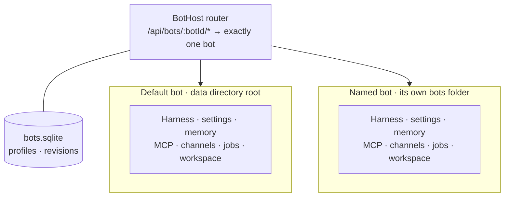
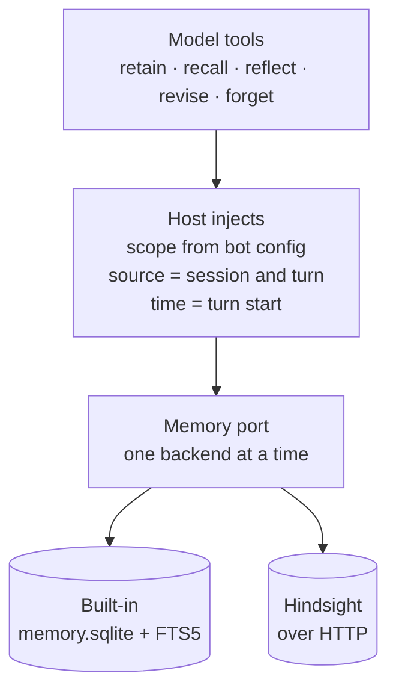
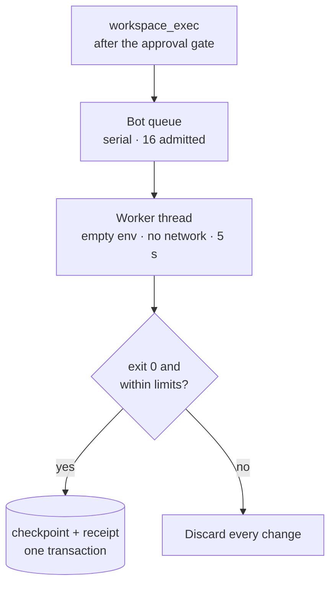
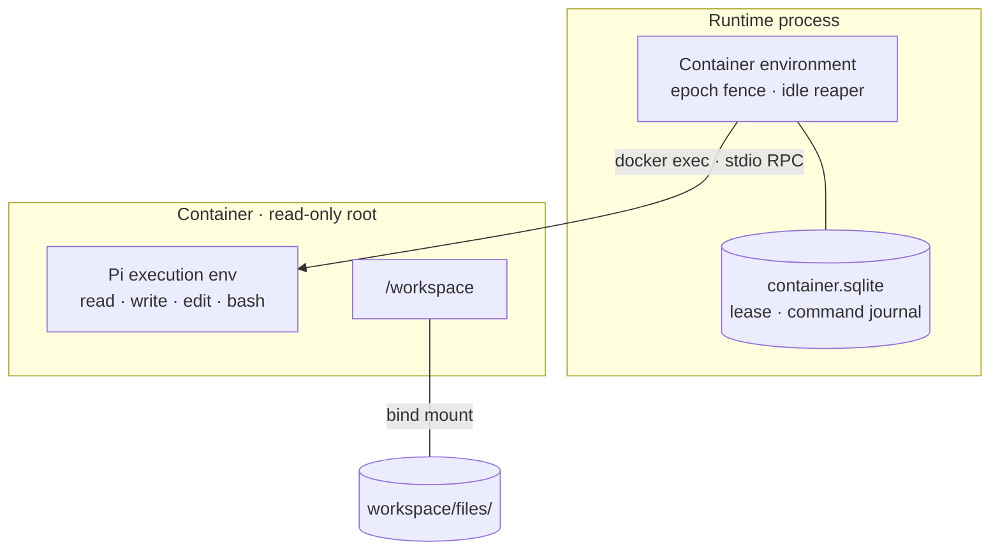

A bot is the ownership boundary for configuration, sessions, memory, tools and files. Every bot runs in the same runtime process, but each has its own harness, stores and credentials, and the model can never reach another bot's state. This is logical separation inside a trusted host, not operating-system isolation.

## Bots: separate state, shared process

`BotHost` composes one bot runtime per bot and owns the bot registry in `bots.sqlite`. Each bot runtime repeats the same stack against its own files.

| Part        | How it works                                                                                                                                                                                                  |
| ----------- | ------------------------------------------------------------------------------------------------------------------------------------------------------------------------------------------------------------- |
| Default bot | Built first. It keeps the original flat data layout and session IDs, and it cannot be deleted. Unprefixed `/api/*` routes address it.                                                                         |
| Named bots  | Get runtime-issued UUIDs and a private directory under `bots/<id>/`. They start with no inherited tools, keys or channels.                                                                                    |
| Routing     | `/api/bots/:botId/*` resolves exactly one bot and rewrites to that bot's route table. Each route factory receives one bot's runtime and cannot resolve its peers. An unavailable bot returns 503.             |
| Actors      | Each bot has its own actor authority. A request context is a frozen object registered with that authority, so it cannot be forged, rebuilt from JSON or reused for another bot.                               |
| Personality | Name, description and SOUL.md are stored with optimistic revisions; the last 50 are retrievable. Edits are refused (409) while the bot has pending turns. Each turn snapshots the personality at admission.   |
| Startup     | All bots attach before any harness resumes, so recovered tasks always find their tools. A deleted bot's directory is removed only after its work is idle; an interrupted deletion finishes on the next start. |

### What is and isn't isolated

| Property                                                   | Holds?  | Mechanism                                                                                                                 |
| ---------------------------------------------------------- | ------- | ------------------------------------------------------------------------------------------------------------------------- |
| Separate sessions, approvals, activity                     | Yes     | One `gateway.sqlite` and harness per bot                                                                                  |
| Separate provider keys, memory, MCP grants, channel config | Yes     | Per-bot stores; each ciphertext is bound to its record                                                                    |
| Model cannot select another bot                            | Yes     | Tools close over their bot when they are built; bot identity never comes from tool arguments                              |
| One Discord or Telegram connection per bot                 | Yes     | The host reserves a connection before connecting. In older data with duplicates, the first bot in profile order keeps it. |
| Concurrency                                                | Per bot | Each bot has its own configuration gate and workspace queue; different bots run in parallel                               |
| Process and OS isolation                                   | No      | Same process, OS user, filesystem permissions and network. A bug in shared code, or the owner, crosses bots.              |

Bot management (create, edit, delete) is an owner HTTP surface only. No model tool can change a bot profile. See [security](/architecture/security/) for the trust boundaries around this.

## Memory: evidence, not transcripts

Memory holds selected facts and confirmed experiences that outlast a session. The model decides what to retain through tools; the host supplies the scope and provenance, so a prompt injection cannot forge either.

| Tool                             | Behaviour                                                                                                                                                             |
| -------------------------------- | --------------------------------------------------------------------------------------------------------------------------------------------------------------------- |
| `memory_retain`                  | Content up to 8,000 characters, kind `fact` or `experience`. Needs an active turn. The evidence ID is derived from the session and tool call, so a replay is a no-op. |
| `memory_recall`                  | Query up to 2,000 characters; returns at most 8 pieces of evidence                                                                                                    |
| `memory_reflect`                 | Built-in returns evidence for the conversation model to reason over; Hindsight returns its own reflection                                                             |
| `memory_revise`, `memory_forget` | Built-in only. They change current evidence, never historical transcripts.                                                                                            |

All memory tools are `replay: "unsafe"`: after a crash they are never re-run, so a corrected or forgotten record cannot come back and an external write is never repeated.

| Backend                | How it stores and searches                                                                                                                                                                                                                                 |
| ---------------------- | ---------------------------------------------------------------------------------------------------------------------------------------------------------------------------------------------------------------------------------------------------------- |
| **Built-in** (default) | `memory.sqlite` with a receipts table (a seen ID is a no-op) and two FTS5 indexes. Recall queries exact terms first, then fills remaining slots from a Porter-stemmed index. Runs with `secure_delete` on.                                                 |
| **Hindsight**          | Writes are synchronous and must be confirmed, or they count as failed (outcome unknown, not retried). Evidence is tagged per scope. A saved key is only ever sent to the endpoint and bank it was saved for. Revise and forget happen in Hindsight itself. |

Configuration is one row per bot: enabled (default on), backend, and scope (default `owner`). Named bots' scopes are prefixed with their bot ID. Changing configuration waits for idle and is refused while turns are pending; memory reads and writes run outside that gate, so a slow backend never blocks chat. Switching backend never migrates data and never falls back silently.

## Workspaces: files durable, compute replaceable

Each bot owns one persistent `/workspace`, shared by all its sessions. Compute is separate from files: a sandbox provider runs commands against the workspace and can be replaced without losing them. Switching provider moves files, never processes or memory.

### just-bash (default)

A command runs in a throwaway worker that gets only the checkpoint and the command: no database paths, host mounts, network, native binaries, Node, Python or `sqlite3`. Only a zero exit produces a new checkpoint, committed together with the tool receipt. That is why `workspace_exec` is replay-safe: after a crash, either both exist (the stored result is returned) or neither does (it runs again from the old checkpoint).

| Limit                       | Value                                                    |
| --------------------------- | -------------------------------------------------------- |
| Wall time                   | 5 s (a host timer kills the worker)                      |
| Command source / output     | 16 KiB / 32 KiB                                          |
| File / checkpoint / entries | 8 MiB / 12 MiB / 1,024                                   |
| Receipts                    | 16 MiB per bot                                           |
| Concurrency                 | Serial per bot, 16 queued per bot, 4 workers per process |

Only `/workspace` persists. `/tmp` and shell state last one command.

### Container (opt-in)

| Control    | Value                                                                                                                                         |
| ---------- | --------------------------------------------------------------------------------------------------------------------------------------------- |
| Mounts     | Only the bot's `workspace/files` at `/workspace`. No home directory, data directory, credentials or container socket.                         |
| Privileges | Host UID and GID, all capabilities dropped, `no-new-privileges`, read-only root, `/tmp` as a 64 MiB tmpfs                                     |
| Resources  | 512 MiB memory, 1 CPU, 128 processes; 30 s per command                                                                                        |
| Budgets    | 4 containers and 4 active operations per process; 16 admitted per bot                                                                         |
| Network    | Bridge networking: the internet, the host and the LAN are reachable. The owner must acknowledge this per bot before choosing the provider.    |
| Lifetime   | One container per bot, created on first use, removed after the idle period (1 to 1,440 minutes, default 10). Files persist; processes do not. |

Control state lives on the host, outside the mount. Opening a provider increments an epoch and removes containers from earlier epochs before the new one is published, so a stale provider can never act again. Every command that can change files is journalled before dispatch; an interrupted one is reported as an unknown outcome and not rerun. There is no rollback: the working tree is the state. See [ADR 0003](/decisions/0003-native-bot-sandbox/).

### Switching provider

Saving sandbox settings runs under the workspace gate and is refused (409) while the bot has pending turns or admitted work. It first fences every native writer by taking a newer epoch, then moves files between the checkpoint and `workspace/files/` in a crash-recoverable way, then saves the setting.

## What each bot stores

| Store                         | Contents                                                                                                                |
| ----------------------------- | ----------------------------------------------------------------------------------------------------------------------- |
| `gateway.sqlite`              | Pi Durable journal and every `raphie.*` document: sessions, turns, approvals, activity, deliveries, bindings, schedules |
| `settings.sqlite`             | Provider connections, default model, telemetry preference, encrypted keys                                               |
| `memory.sqlite`               | Memory configuration, built-in evidence and search indexes                                                              |
| `mcp.sqlite`                  | MCP connections and encrypted OAuth grants                                                                              |
| `channels.sqlite`             | Discord configuration and encrypted token                                                                               |
| `telegram.sqlite`             | Encrypted Telegram configuration and the durable polling position                                                       |
| `files/`                      | Content-addressed uploaded originals                                                                                    |
| `workspace/checkpoint.sqlite` | Sandbox settings, the just-bash checkpoint and execution receipts                                                       |
| `workspace/container.sqlite`  | Container lease and command journal                                                                                     |
| `workspace/files/`            | The disk view of `/workspace`                                                                                           |

The default bot keeps these at the root of the data directory; each named bot has the same layout under `bots/<id>/`. See [storage](/architecture/storage-and-telemetry/) for host-level stores.

## Limits

- Bots share one process, OS user and network; a container sandbox shares the host kernel and can reach host and LAN services.
- Memory has no background consolidation; reflection is synthesis by the conversation model (built-in) or by Hindsight.
- There is no cross-bot file or memory sharing operation.

## Related

- [Bots](/guides/bots/), [memory](/guides/memory/) and [workspaces](/guides/workspaces/) for the owner's view
- [Execution](/architecture/execution/) for approvals and replay rules
