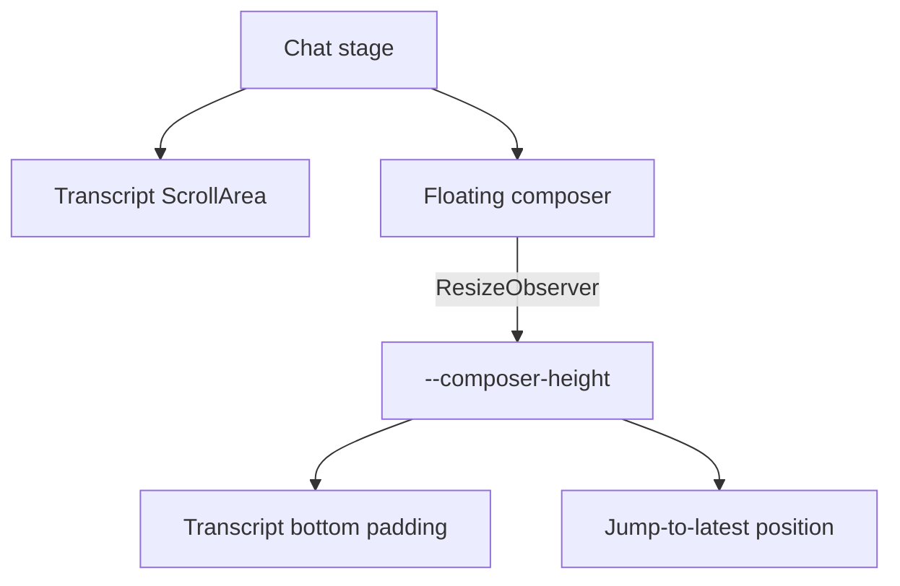

import { Steps } from "@astrojs/starlight/components";

Web UI in `apps/web` uses shadcn components built on Base UI, CSS scoped to explicit class names, and one shared scroll area for every scrolling region. Check every changed screen on the fixture in both themes before calling it done.

## Rules

| Rule                                                                                                                          | Why                                                                                                                   |
| ----------------------------------------------------------------------------------------------------------------------------- | --------------------------------------------------------------------------------------------------------------------- |
| Use shadcn components on Base UI (`apps/web/src/shared/ui`). Do not add Radix, or a native control where a shadcn one exists. | One component system, one look, one accessibility model.                                                              |
| Scope CSS to explicit class names. Never use `> div` or bare element descendant selectors.                                    | Broad selectors have stretched unrelated controls before.                                                             |
| Use the shared `ScrollArea` for anything that scrolls.                                                                        | One scrolling model, custom scrollbars, no competing native scrollers.                                                |
| The browser imports `@raphie/contracts`, never runtime internals.                                                             | Keeps the web app a client of the HTTP API.                                                                           |
| Any change to the web design is mirrored in the desktop client.                                                               | It copies the web's look by value; see [desktop development](/contribute/desktop-development/#keep-the-look-in-sync). |

The shadcn configuration is `apps/web/components.json` (style `base-nova`); generated components land in `src/shared/ui`.

## Scrolling

`src/shared/ui/scroll-area.tsx` wraps `@base-ui/react/scroll-area`. Base UI owns the viewport and the custom thumb. Panels and other ancestors constrain size but never scroll themselves.

The transcript, code blocks, tables, approval and activity details, settings pages, the session list and long drafts all use this one component. A wide code block or table scrolls inside its own area; the page never scrolls sideways.

The transcript's `useStickToBottom` (from `use-stick-to-bottom`) points straight at the scroll area's viewport and content. That keeps three behaviours:

- the transcript follows a streaming reply while you are at the bottom;
- scrolling up to read stops the following;
- the jump-to-latest button brings you back.

## The floating composer



The composer floats over the bottom of the chat stage, so messages scroll underneath it. `use-composer-layout.ts` watches the composer with a `ResizeObserver` and publishes its height as `--composer-height` on the stage. The transcript's bottom padding and the jump button use that variable, so the last message stays reachable above the card as drafts, errors and toolbars grow.

The textarea grows inside its own capped scroll area. Caret tracking keeps the line you are editing visible without a second scrollbar.

## Reproduce and verify

Use only the disposable fixture, on ports 4317 and 4321. Never test against the real app or `.data/`.

<Steps>

1. Start the fixture with a long synthetic history:

   ```sh
   RAPHIE_FIXTURE_LONG_HISTORY=true bun run --parallel dev:fixture dev:web:fixture
   ```

2. Open `http://127.0.0.1:4321` and the fixture's saved session. It holds 60 long synthetic replies with wide code, tables and detailed activity. The data is temporary and calls no remote model.
3. Run the layout probe. `scripts/check-scroll-layout.browser.js` exports `checkScrollLayout()`; strip the `export` and evaluate it in the page. It throws if a native scroll container appears, the transcript stops above the composer, or the page overflows sideways.
4. Check by eye in light and dark, at 2x zoom and at a mobile width (320 px), plus 768, 1024 and 1440 px.

</Steps>

What to confirm by eye:

- one transcript scrollbar, with wide code and tables scrolling only inside themselves;
- the last reply sits above the composer after jump-to-latest;
- reading older messages during a streamed reply keeps your position;
- a 25-line draft scrolls inside the composer, and editing its first or last line keeps the caret visible;
- activity payloads stay capped with custom scrollbars;
- mobile navigation and settings use the same scroll areas.

:::caution
DOM metrics and small screenshots miss misalignment. The probe catches structural regressions; only looking at the rendered screens catches the rest. Attach screenshots to the pull request, never commit them.
:::

Other probes for specific screens live beside it in `scripts/` as `check-*.browser.js` and run the same way.
