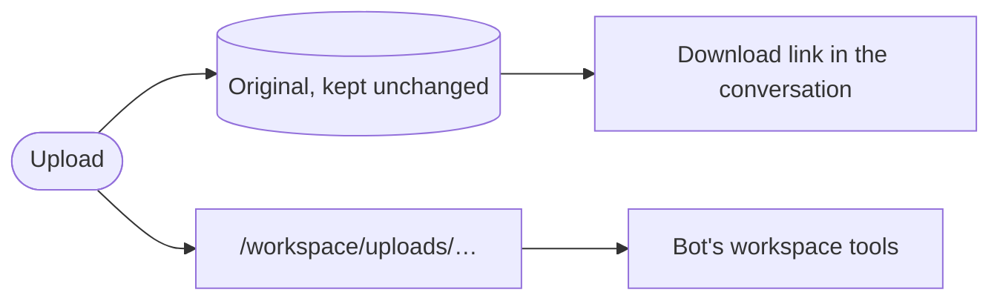

import { Steps } from "@astrojs/starlight/components";

Attach up to four files, each up to 8 MiB, to a message in the web workspace or desktop client. Each file is saved into the bot's workspace, where its tools can read it, and images also go straight to the model when the model accepts images.

## Attach files

<Steps>

1. Choose **Attach files** in the composer and pick one or more files. They upload one at a time and appear as chips above the draft, with thumbnails for images.
2. Write a message, or leave it empty: a message can be files alone.
3. Send.

</Steps>

You can attach files while the bot is busy; they queue with the message like any other. Removing a chip only detaches the file from the draft; the uploaded copy stays in the workspace.

If an upload or send fails, your text and the files that did upload stay in the draft so you can retry.

## Where files go

| Copy         | Where                                                                          | Changes?                                                                  |
| ------------ | ------------------------------------------------------------------------------ | ------------------------------------------------------------------------- |
| Working copy | `/workspace/uploads/<id>/<name>` in the bot's [workspace](/guides/workspaces/) | Yes. The bot's tools can edit, move or delete it.                         |
| Original     | The bot's attachment archive, outside the sandbox                              | Never. The download link on the message always returns these exact bytes. |

The same file with the same name gets the same ID, so uploading it twice does not create a second copy. Each bot has its own uploads and archive.

Old messages keep pointing at the original, so a download never changes even if the working copy is later edited or deleted.

## What the model receives

| File                                                       | Model accepts images                                      | Text-only model         |
| ---------------------------------------------------------- | --------------------------------------------------------- | ----------------------- |
| PNG, JPEG, GIF, WebP                                       | The image itself, plus its workspace path                 | The workspace path only |
| PDF, Word, Excel, PowerPoint, CSV, OpenDocument, RTF, EPUB | The workspace path; the bot reads it with `read_document` | Same                    |
| Anything else                                              | The workspace path; the bot can use its workspace tools   | Same                    |

Image formats are detected from the file's bytes, not its name. Images are sent as they are: Raphie does not resize, convert or run OCR on them, and a provider may still reject a file it considers too large or unsupported.

`read_document` converts documents to text locally, with no network calls, and returns it in chunks of 16,000 characters. For PDFs with scanned pages it falls back to plain text extraction of up to 200 pages and says which pages came back empty.

## Limits

| Limit                       | Value                                                                                                                           |
| --------------------------- | ------------------------------------------------------------------------------------------------------------------------------- |
| Files per message           | 4                                                                                                                               |
| Size per file               | 8 MiB                                                                                                                           |
| Message text                | 4,000 characters                                                                                                                |
| Default sandbox (just-bash) | The whole workspace must fit in 8 MiB and 1,024 entries, so large uploads may not fit. Use the container sandbox for more room. |
| OCR                         | None. Text inside images and scanned pages is not extracted.                                                                    |
| Channels                    | Telegram and Discord chat accept text only.                                                                                     |

If an upload doesn't fit in the workspace, it fails without changing existing files or messages.

:::note
Originals are never cleaned up automatically, including uploads you never sent. They use disk space in the data directory until you delete the bot. Back them up with the rest of the data; see [backup and recovery](/operate/backup-and-recovery/).
:::
