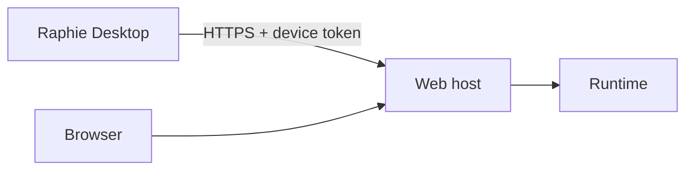

import { Steps } from "@astrojs/starlight/components";

Raphie Desktop is a native app for the daily loop: pick a bot and a conversation, send messages, watch replies stream in, and approve tool actions. It looks like the web workspace and talks to the same web host, so it works the same whether Raphie runs on this computer or on a server in your tailnet.

It is built for macOS first. There is no installer yet: you build it from source.



## What it does

| Area           | What you can do                                                                                                                                                                                |
| -------------- | ---------------------------------------------------------------------------------------------------------------------------------------------------------------------------------------------- |
| Conversations  | Browse every bot's sessions, search titles, filter to new replies or pending approvals, read history, send with Return (Shift-Return for a new line).                                          |
| Replies        | Streamed Markdown with highlighted code; the tools each run used, with their arguments, results, timing, tokens and cost.                                                                      |
| While it works | **Stop** a run, or queue a message and switch it to steer after the current step.                                                                                                              |
| Approvals      | **Approve once** or **Reject** with the exact arguments; **Approve for session** for commands.                                                                                                 |
| Composer       | Choose the model and the command permission mode (**Ask** or **Full access**); attach up to four files of 8 MiB each by picker, drag and drop or paste.                                        |
| Notifications  | A bell with new replies, approvals and scheduled job runs across all bots, plus system notifications when the window is in the background.                                                     |
| Settings       | Every bot page the web has except UI plugins: Profile, Providers, Models, Memory, MCP tools, Channels, Sandbox, Workspace, Scheduled jobs, Activity, plus Account, Appearance and Diagnostics. |
| Updates        | **About** checks whether a newer Raphie release exists and links to it. It installs nothing.                                                                                                   |

What you read is shared with the web: a reply read in one client counts as read in the other. Secrets you type (provider keys, bot tokens, MCP tokens) are sent to the server once and never stored or shown by the app.

For a side-by-side view with the web workspace and other clients, see [clients](/guides/clients/).

## Install and run

You need a Rust toolchain from [rustup](https://rustup.rs) and a copy of the Raphie repository. The right Rust version installs itself on first build, and the first build takes several minutes.

```sh
cd apps/desktop
cargo run --release -p raphie-desktop
```

To get a real macOS app with system notifications, build a bundle and open it:

```sh
cd apps/desktop
scripts/bundle.sh --release
open target/bundle/Raphie.app
```

The bundle is signed only for this machine. macOS asks once whether Raphie may send notifications. A plain `cargo run` posts no system notifications.

## Sign in

The app signs in with a device code, so your password never goes into it.

<Steps>

1. Start the app and enter your Raphie address, for example `http://127.0.0.1:4320` or `https://raphie.your-tailnet.ts.net`.
2. Choose **Connect**, then **Open approval page**.
3. Sign in to Raphie in the browser, check that the code matches the one in the app, and approve the device.

</Steps>

The token is saved in the system credential store (the login Keychain on macOS), one per address, and reused at the next launch. You can also pass the address at launch: `cargo run --release -p raphie-desktop -- --origin https://raphie.your-tailnet.ts.net`.

**Sign out** (at the bottom of the bot list) forgets the token on this computer, but the device stays listed in the web workspace's **Settings → Account**. Disconnect it there to revoke it fully. If the server rejects the token, for example because you disconnected the device, the app deletes it and returns to sign-in.

See [authentication](/operate/authentication/) for how device sign-in works on the server side.

## Connect over a tailnet

Set up an HTTPS address for the web host first; see [remote access](/operate/remote-access/). Then enter that `https://` address at sign-in.

The app accepts plain `http://` only for `127.0.0.1`, `localhost` and `[::1]`, so a token never crosses a network unencrypted. It follows no redirects.

## Limits

- Built and tested on macOS (Apple silicon). It compiles for Windows and Linux, but they are untested.
- No installer, Developer ID signature or notarisation. Without the app bundle, macOS may ask for Keychain access on first use.
- It connects to a Raphie server that is already running; it does not start or manage one.
- The **Account** page has no device list or passkeys. Manage those in the browser.
- Approvals given for a session cannot be listed or revoked here (nor on the web).
- One message in flight at a time from the composer.
- Tool steps come from a session's latest 200 events, so older turns show their reply without steps.
- The window is at least 960 by 560 points.
