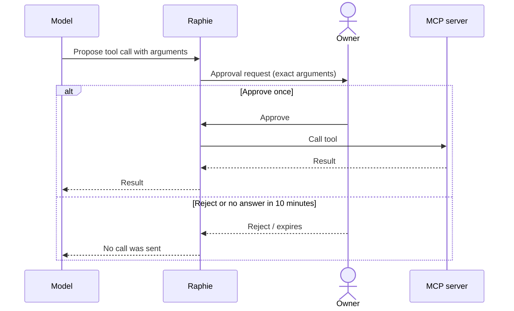

import { Steps, TabItem, Tabs } from "@astrojs/starlight/components";

A bot reaches outside services through MCP servers that you connect to that bot alone. Raphie encrypts each connection's configuration on disk, and every tool call waits for you to approve its exact arguments before anything is sent.

Connections are per bot: another bot never sees them, their tools or their sign-ins.

## Add a server

Open **Settings**, choose the bot, then **MCP tools**, and fill in **Add a connection**.

<Tabs>
<TabItem label="Remote (Streamable HTTP)">

<Steps>

1. Enter a **Connection name** and choose **Streamable HTTP**.
2. Enter the **Server URL**. Use `https://`; plain `http://` is accepted only for loopback addresses.
3. If the server takes a static token, paste it into **Bearer token (optional)**. Leave it empty if the server supports MCP sign-in.
4. Choose **Connect server**.
5. If the connection shows **Authorization required**, choose **Authorize**, sign in on the server's page in the new tab, and grant access. The status updates by itself.

</Steps>

</TabItem>
<TabItem label="Local command (stdio)">

<Steps>

1. Enter a **Connection name** and choose **Local command (stdio)**.
2. Enter the **Command**, for example `npx`.
3. Enter **Arguments (JSON array)**, for example `["-y", "your-mcp-server"]`.
4. Add any secrets the server needs in **Environment (JSON object, optional)**, for example `{"API_TOKEN": "…"}`.
5. Choose **Connect server**.

</Steps>

</TabItem>
</Tabs>

:::caution[Local commands are not sandboxed]
A stdio server runs on the Raphie host as the same user account as Raphie, outside the bot's [sandbox](/guides/workspaces/). It receives only `PATH` and the environment values you enter, not Raphie's own environment. Connect only commands you trust.
:::

## Manage connections

| Action                     | Effect                                                                                |
| -------------------------- | ------------------------------------------------------------------------------------- |
| **Pause**                  | Disconnects the server and removes its tools from the bot. Saved configuration stays. |
| **Enable** / **Reconnect** | Starts the connection again, refreshing an expired sign-in when the server allows it. |
| **Cancel authorization**   | Abandons a sign-in that is still waiting.                                             |
| **Remove**                 | Deletes the connection and its saved secrets.                                         |

To change a connection, remove it and add the replacement. Changes are refused while the bot has a turn running or an approval waiting.

## How a tool call is approved

Connecting a server lets the bot see its tools; it does not let the bot run them. Each call the model proposes becomes an approval for that exact server, tool and arguments, even for tools that describe themselves as read-only.

- You decide in the web workspace or the desktop client (**Approve once** or **Reject**), or in a private Telegram chat for turns started there (**Approve once** or **Decline**).
- An approval expires after 10 minutes. The bot is told no call was sent.
- Approvals are per call. There is no "always allow" for MCP tools, and a conversation's command permission mode (**Ask** or **Full access**) does not apply to them.
- Arguments larger than 64 KiB are refused before an approval is created.
- Results longer than 30,000 characters are cut short, and the bot is told to ask for less.

When the MCP server itself has approvals (for example, Executor), both apply: Raphie approves the call to the server, and the server governs what happens inside it.

## Where secrets live

Tokens, command arguments, environment values and sign-in grants are encrypted in that bot's `mcp.sqlite`, using the same credential key store as model provider keys. The database is readable only by Raphie's user account. Raphie never returns saved secrets through its API or shows them again in Settings. See [credentials](/operate/credentials/) for how the key is stored and recovered.

### Environment configuration

The default bot can also take one connection from the `MCP_TRANSPORT`, `MCP_URL`, `MCP_BEARER_TOKEN`, `MCP_COMMAND` and `MCP_ARGS` variables. Settings marks it **Environment configuration · default bot only**. To manage it like any other connection, choose **Import encrypted copy**; after that Raphie ignores the variables, even if you later remove the saved connection.

## When something fails

| Situation                                  | What happens                                                                                                  |
| ------------------------------------------ | ------------------------------------------------------------------------------------------------------------- |
| Server unreachable at startup              | The bot still starts. The connection shows as disconnected; choose **Reconnect** once the server is back.     |
| Server goes down later                     | The status reflects the last connection attempt, not live health. Calls fail with an error the bot can read.  |
| Sign-in not finished within five minutes   | The sign-in expires. Choose **Reconnect** to start again.                                                     |
| Raphie stops while a call is running       | The call is marked uncertain and never repeated automatically. Check the outside service before asking again. |
| Server needs a pre-registered OAuth client | Not supported. Paste a bearer token instead if the server issues one.                                         |

Finishing an **Authorize** sign-in needs a browser that can reach Raphie's loopback callback, so do it on the Raphie machine.

## Limits

| Limit                          | Value                                                  |
| ------------------------------ | ------------------------------------------------------ |
| Connections per bot            | 16                                                     |
| Transports                     | Streamable HTTP and stdio; legacy SSE is not supported |
| Connection name                | 80 characters                                          |
| Arguments / environment values | 64 each                                                |
| Approval lifetime              | 10 minutes                                             |

## Related

- [Approvals in conversations](/guides/conversations/)
- [Durable execution and approvals](/architecture/execution/)
- [Trust boundaries](/architecture/security/)
