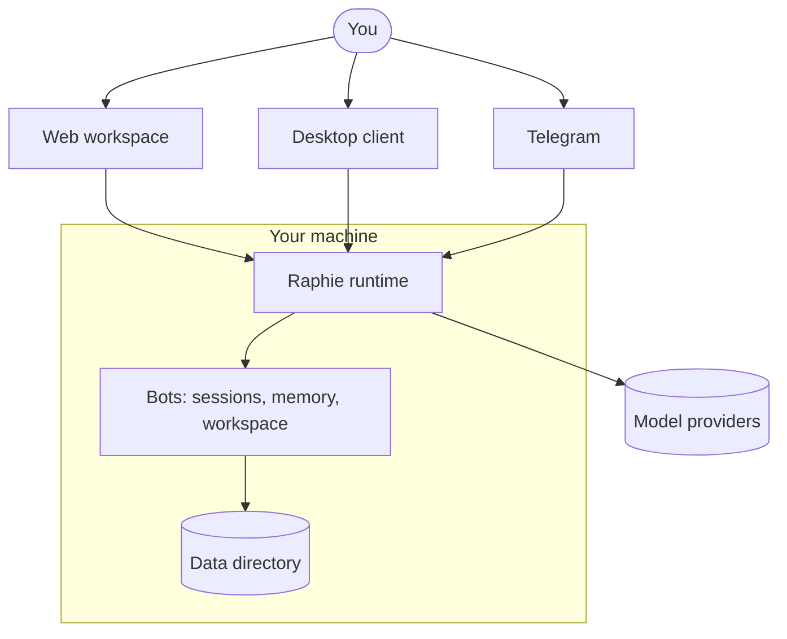

import { Card, CardGrid, LinkCard } from "@astrojs/starlight/components";

## Up and running in a minute

```sh
curl -fsSL https://raw.githubusercontent.com/kalibetre/raphie/main/scripts/install.sh | bash
raphie health        # in a new terminal
raphie auth setup    # create your administrator
```

Then open `http://127.0.0.1:4320`, sign in and connect a model provider. [First run](/start/first-run/) walks through it.

## What a bot has

<CardGrid>
  <Card title="A personality" icon="star">
    A name, a description and a revisioned SOUL.md you write.
    [Bots](/guides/bots/)
  </Card>
  <Card title="Memory it can correct" icon="document">
    It remembers across sessions; you can browse, fix and forget.
    [Memory](/guides/memory/)
  </Card>
  <Card title="A workspace" icon="laptop">
    Files that persist, run in a bounded shell or a container.
    [Workspaces](/guides/workspaces/)
  </Card>
  <Card title="Tools and schedules" icon="puzzle">
    MCP servers per bot, and prompts that run on a timer.
    [Tools](/guides/tools/) · [Schedules](/guides/schedules/)
  </Card>
</CardGrid>

## How it fits together



Everything runs in one runtime you own, with one data directory. Clients and channels are ways in; they never hold your data. [Architecture overview](/architecture/overview/)

## Find your way

<CardGrid>
  <LinkCard
    title="Use it"
    description="Conversations, bots, memory, workspaces, tools, Telegram and the desktop client."
    href="/guides/conversations/"
  />
  <LinkCard
    title="Run it"
    description="The raphie command, the background service, remote access, backups and recovery."
    href="/operate/commands/"
  />
  <LinkCard
    title="Secure it"
    description="Administrator sign-in, devices, credential storage and what each layer protects."
    href="/operate/authentication/"
  />
  <LinkCard
    title="Understand it"
    description="Durable turns, approvals, isolation between bots, storage and the HTTP API."
    href="/architecture/overview/"
  />
</CardGrid>
