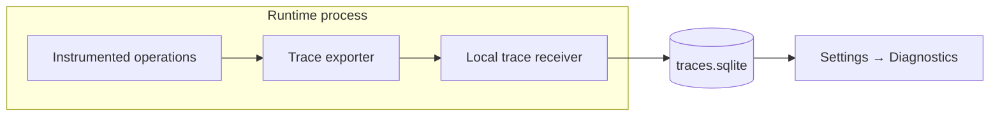

Raphie records what it does in two separate places. **Activity** is the durable record of each bot's runs, used for recovery and for reviewing a session. **Diagnostics** shows operational traces: timings, token counts and errors, kept for 48 hours on the Raphie machine. Nothing is sent to an outside monitoring or analytics service.

## Which one to use

|                   | Activity                                                                       | Diagnostics                                                        |
| ----------------- | ------------------------------------------------------------------------------ | ------------------------------------------------------------------ |
| Answers           | What happened in this session or bot: model, tool, approval and recovery steps | How long things took, where they failed, how many tokens they used |
| Where to see it   | The Activity panel in a session; **Settings → Activity** for a bot             | **Settings → Diagnostics**, one page for every bot                 |
| Stored in         | Each bot's execution database                                                  | `traces.sqlite` in the data directory, shared by all bots          |
| Kept for          | The latest 5,000 events per bot, across restarts                               | 48 hours, at most 100,000 spans                                    |
| Can be turned off | No; recovery depends on it                                                     | Yes, with **Collect diagnostic traces**                            |
| Delivery          | Written in the same transaction as the work it describes                       | Best effort; spans can be lost                                     |

Neither shows private model reasoning. Activity and traces are independent: old Activity is never converted into traces, and Diagnostics never falls back to Activity.

## How traces are stored

The runtime starts its own small trace receiver on a loopback port the operating system picks. Spans are exported to it over OTLP/HTTP as JSON, checked, stripped down to approved fields and written to `traces.sqlite`. There is no collector, container or cloud service to run.

| Setting          | Value                                                                                      |
| ---------------- | ------------------------------------------------------------------------------------------ |
| File             | `traces.sqlite` in the data directory, mode `0600`                                         |
| Retention        | 48 hours and at most 100,000 spans, pruned as spans arrive and are read                    |
| Attribute length | Each text attribute is cut to 512 characters                                               |
| Export batches   | Up to 256 spans, flushed about every second                                                |
| Receiver limits  | `POST /v1/traces`, JSON only, 4 MiB and 1,000 spans per batch; browser origins are refused |
| Service name     | `raphie-runtime`, or `OTEL_SERVICE_NAME` if set                                            |

The receiver handles only this trace format. It does not accept metrics, logs, protobuf or gRPC, and does not forward anything.

Pruning frees space inside the file for reuse; the file itself may not shrink right away.

## Reading Diagnostics

**Settings → Diagnostics** lists the latest 500 spans in the chosen window, newest first. It refreshes every five seconds while open.

- Choose a 1, 6 or 24 hour window, and filter by text.
- Expand a span to see its IDs, timing, status and recorded attributes, including which bot it belongs to.
- Download the visible traces as JSON.

The same data is available from the runtime at `GET /api/diagnostics/traces?hours=1`, with `6` or `24` as the other windows. See the [HTTP API](/architecture/http-api/).

Polling Diagnostics is itself never traced, so the page does not fill up with its own requests.

## What is traced

| Span                         | Covers                                                                 |
| ---------------------------- | ---------------------------------------------------------------------- |
| `runtime.start`              | Opening, migrating and recovering the runtime                          |
| `http.request`               | One HTTP request, until response headers are sent                      |
| `session.submit`             | Admitting a message as a turn, not the model's answer                  |
| `agent.run`                  | One agent run, including model calls and waits for tools and approvals |
| `model.generate`             | One model attempt, from start to response                              |
| `model.retry`                | The wait between model attempts                                        |
| `approval.decide`            | An owner's decision on a proposed tool call                            |
| `tool.call`                  | One call to an MCP server                                              |
| `delivery.send`              | One attempt to send or edit a message in a channel                     |
| `file.submit`, `file.decide` | The file-copy command and its approval                                 |

Each span carries the bot it belongs to. Model attempts and retries appear inside their agent run; other spans are linked by session, turn, approval and delivery IDs.

Spans are written when they finish, so work in progress appears once it completes. When Raphie shuts down, unfinished spans end as interrupted. A run recovered after a crash starts a new trace marked partial; earlier timing is not reconstructed.

## What is recorded, and what is not

Only a fixed list of fields reaches the trace store. Anything else a span carries is dropped on arrival.

| Recorded                                              | Never recorded                                    |
| ----------------------------------------------------- | ------------------------------------------------- |
| Bot, session, turn, approval and delivery IDs         | Prompts, message text and model responses         |
| Tool name and request source                          | Tool arguments and results                        |
| HTTP method, route pattern and status code            | Raw URLs and headers                              |
| Model provider, model ID, attempt number, stop reason | Attachment names                                  |
| Input, output and cache token counts                  | Raw error messages; a failure records a fixed tag |
| Runtime and service versions, runtime attempt ID      | Credentials                                       |

## Turning traces off

Open **Settings → Diagnostics** and switch off **Collect diagnostic traces**. Tracing is on by default.

- The change takes effect immediately, without a restart.
- No new spans start. Spans already running may still finish and be stored.
- Existing traces stay until retention removes them.
- Activity, recovery and the work itself are unaffected.

## When tracing fails

Tracing never changes the outcome of the work it observes.

- If the receiver or trace store is unavailable, operations still run once and return normally. Diagnostics says the store is unavailable.
- The exporter may retry sending spans, but it never retries the operation itself: a model call, tool call or channel delivery.
- A crash or forced stop can lose spans that were not yet exported.
- On shutdown, Raphie waits up to two seconds to flush remaining spans.
