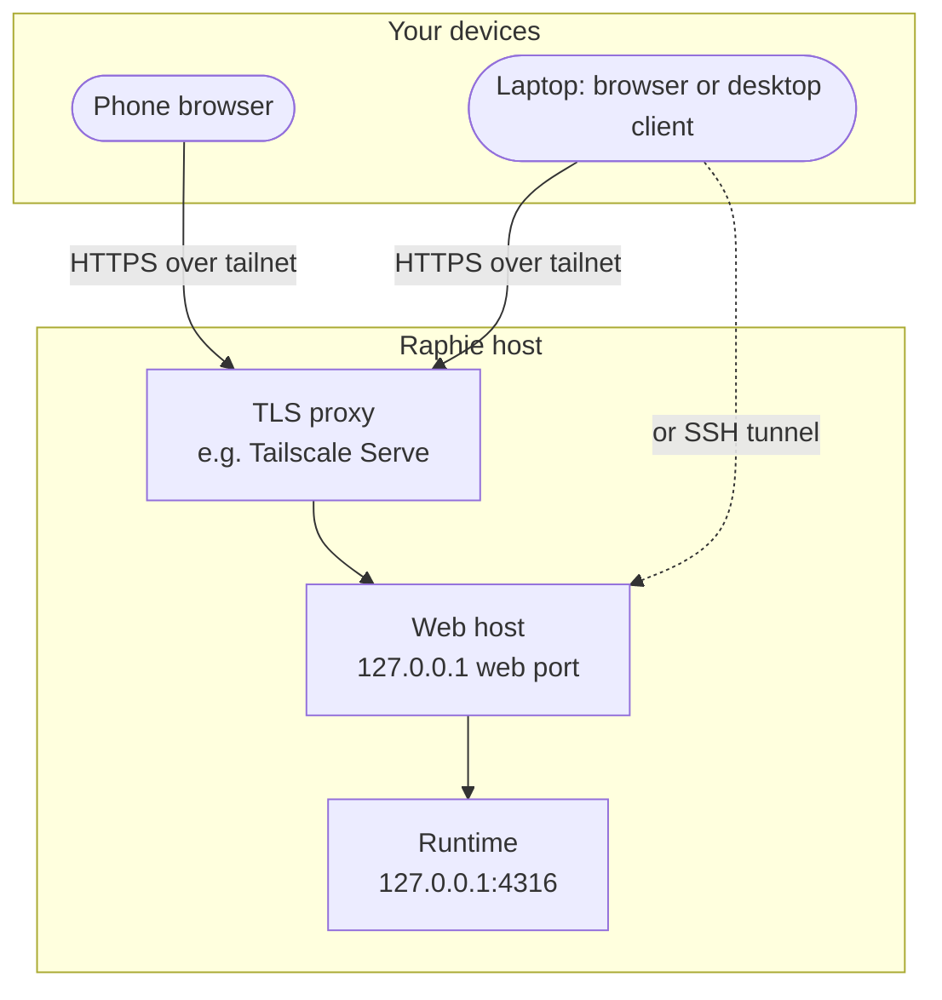

import { Steps, TabItem, Tabs } from "@astrojs/starlight/components";

Raphie listens on `127.0.0.1` only, so nothing outside the machine can reach it until you add a path in. Use an **SSH tunnel** for occasional access, or a **tailnet with HTTPS** (such as Tailscale Serve) for everyday use from your other devices. Either way, only the web port is ever exposed, and only through something that encrypts it.



## SSH tunnel

The simplest option: no configuration on the server, and the browser still uses a loopback address.

```sh
ssh -L 4320:127.0.0.1:4320 you@server     # user install
ssh -L 41837:127.0.0.1:41837 you@server   # system service (or your chosen port)
```

Leave it open and visit `http://127.0.0.1:4320` (or `:41837`) on your own computer.

## Tailnet with HTTPS

A tailnet gives every device you approve a private HTTPS address for Raphie. The steps use [Tailscale](https://tailscale.com); any TLS-terminating proxy that preserves the `Host` header works the same way.

<Steps>

1. **Prepare the tailnet.** In the Tailscale admin console, enable [MagicDNS and HTTPS certificates](https://tailscale.com/kb/1153/enabling-https), and set access controls so only your devices can reach the server.

2. **Tell Raphie its new origin.** Use the server's lowercase Tailscale name, with no trailing slash, for example `https://raphie-host.your-tailnet.ts.net`. See [add an origin](#add-an-origin) for your install.

3. **Serve the web port over HTTPS.** Point Tailscale Serve at the web port, never at 4316:

   ```sh
   sudo tailscale serve --bg http://127.0.0.1:41837   # system service
   tailscale serve --bg http://127.0.0.1:4320         # user install
   ```

   On Linux, `tailscale serve` needs `sudo` unless your user is the Tailscale operator.

4. **Sign in from another device** on the tailnet at the HTTPS address. Each origin has its own browser sign-in, so you sign in once per address. The [desktop client](/guides/desktop/) takes the same address and signs in with a device code.

</Steps>

## Add an origin

Add the HTTPS address to the origins Raphie accepts. The local loopback addresses keep working.

<Tabs syncKey="install">
<TabItem label="System service">

```sh
sudo raphie set-origins "https://raphie-host.your-tailnet.ts.net"
```

Or pass `--web-origin https://...` when installing. `set-origins` restarts the service.

</TabItem>
<TabItem label="User install, Linux">

```sh
systemctl --user edit raphie
```

Add the origin, save, then restart:

```ini
[Service]
Environment=RAPHIE_WEB_ALLOWED_ORIGINS=https://raphie-host.your-tailnet.ts.net
```

```sh
systemctl --user restart raphie
```

</TabItem>
<TabItem label="User install, macOS">

```sh
plist=~/Library/LaunchAgents/com.raphie.user.plist
plutil -replace EnvironmentVariables.RAPHIE_WEB_ALLOWED_ORIGINS \
  -string "https://raphie-host.your-tailnet.ts.net" "$plist"
launchctl bootout gui/$(id -u) "$plist"
launchctl bootstrap gui/$(id -u) "$plist"
```

</TabItem>
</Tabs>

## Origins

Raphie checks every request's `Host` and, for browser changes, its `Origin` against a fixed list. Requests from anywhere else get `403`.

| Origin                                            | Allowed when                         |
| ------------------------------------------------- | ------------------------------------ |
| `http://127.0.0.1:PORT`, `http://localhost:PORT`  | Always, on the local web port        |
| Primary origin (`RAPHIE_WEB_ORIGIN`)              | Set at install; defaults to loopback |
| Additional origins (`RAPHIE_WEB_ALLOWED_ORIGINS`) | Each listed exactly, comma-separated |

Write origins exactly: lowercase, scheme, host, a non-default port if any, no path. Anything other than `127.0.0.1` or `localhost` must be `https://`, and the same host and port cannot appear with both schemes. On the system service, `sudo raphie origins` shows the current list.

## What is safe to expose

| Expose                                                          | Safe?                                                                                    |
| --------------------------------------------------------------- | ---------------------------------------------------------------------------------------- |
| Web port through HTTPS to a tailnet with tight access controls  | Yes. This is the intended setup.                                                         |
| Web port through an SSH tunnel                                  | Yes.                                                                                     |
| Web port over plain HTTP to a network                           | No. Raphie refuses non-loopback HTTP origins.                                            |
| Web port to the public internet (for example, Tailscale Funnel) | No. Sign-in throttling stops repeated guesses of one password, not distributed guessing. |
| Runtime port `4316`, by any route                               | Never. It has no authentication and trusts local processes.                              |

:::caution
Keep the tailnet's access controls tight. Raphie's administrator sign-in protects the web workspace, but it is the only barrier once a device can reach the HTTPS address. Raphie ignores forwarded client-address headers and does not use Tailscale identity for sign-in.
:::

Related: [authentication](/operate/authentication/) for sign-in, passkeys and device approval; [service](/operate/service/#ports-and-origins) for port defaults.
