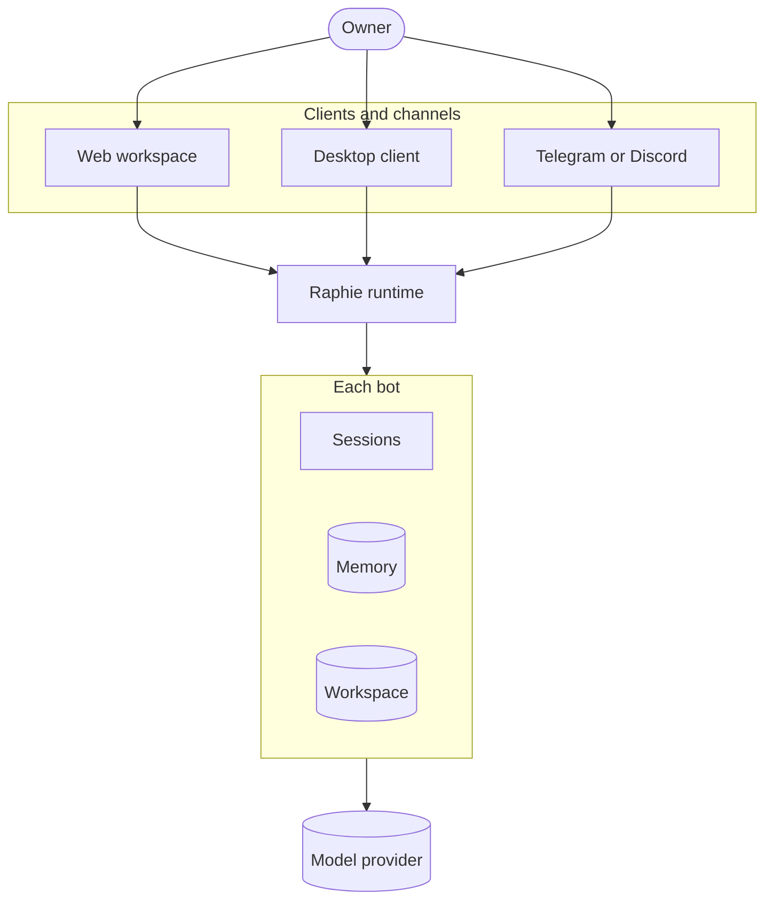

import { CardGrid, LinkCard } from "@astrojs/starlight/components";

Raphie is a self-hosted assistant you run on your own machine. It hosts one or more persistent **bots**, each with its own instructions, memory, workspace and scheduled work, and you talk to them from a browser, a desktop app or a messaging channel.

Everything runs in one runtime process that you own. Model calls go to the provider you connect; your conversations, memory and files stay in Raphie's data directory.

## How it fits together

You are the **owner**: the one person with authority over every bot. Clients and channels are only ways in; the same session, approval or memory record looks the same whichever one you use.

## Core concepts

| Term            | What it means                                                                                                                                          |
| --------------- | ------------------------------------------------------------------------------------------------------------------------------------------------------ |
| **Bot**         | A persistent assistant identity with its own personality, model connections, sessions, memory and workspace. Raphie starts with one, named Raphie.     |
| **Personality** | The bot's voice, values and style, written by you in its `SOUL.md`. It shapes behaviour but grants no capabilities.                                    |
| **Session**     | A durable conversation with its own history, belonging to one bot. It is the same session whether you reach it from the browser, desktop or a channel. |
| **Turn**        | One message you send plus all the agent work that answers it: possibly several model responses and tool actions.                                       |
| **Workspace**   | A bot's persistent working files, shared by all its sessions. Not the same as the **web workspace**, which is the browser app.                         |
| **Sandbox**     | The replaceable environment that runs commands against a bot's workspace, within limits you set.                                                       |
| **Memory**      | Selected facts and preferences a bot keeps across sessions, each with a source. Not a copy of every transcript.                                        |
| **Channel**     | An external messaging platform you can talk to a bot through, such as Telegram or Discord.                                                             |
| **Client**      | An app you use to work with Raphie: the web workspace or the desktop client.                                                                           |
| **Approval**    | Your decision about one exact proposed action and its arguments. Approving does not prove the action succeeded.                                        |

The full glossary is on the [glossary](/contribute/glossary/) page.

## Where to next

<CardGrid>
  <LinkCard
    title="Install Raphie"
    description="User install, Linux service or from source."
    href="/start/installation/"
  />
  <LinkCard
    title="First run"
    description="Sign in, connect a model provider and start a conversation."
    href="/start/first-run/"
  />
  <LinkCard
    title="Conversations"
    description="Find your way around the web workspace."
    href="/guides/conversations/"
  />
  <LinkCard
    title="Bots"
    description="Create bots and give each its own personality."
    href="/guides/bots/"
  />
</CardGrid>
